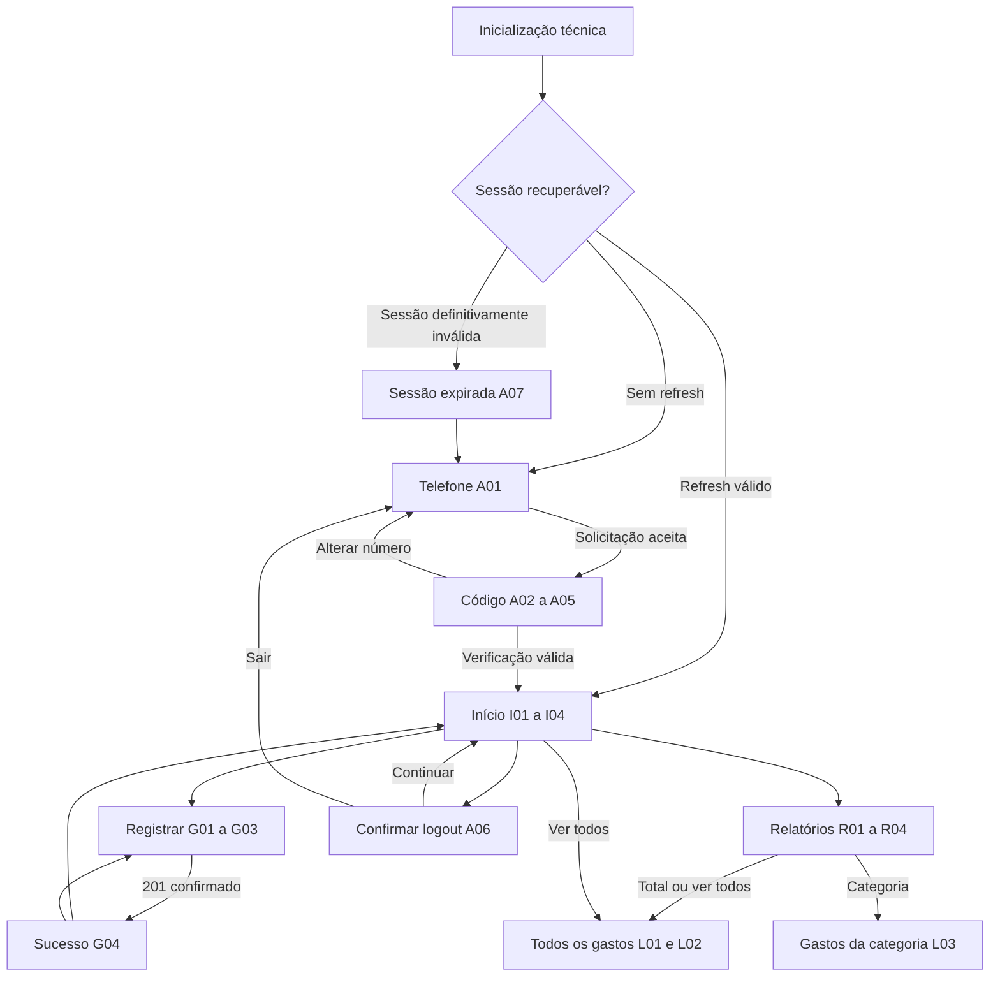
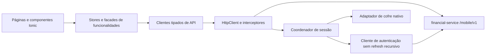

# SDD — Finance Tracker Mobile com Ionic

**Versão:** 1.1 — proposta para revisão, atualizada com as cinco imagens fornecidas. **Data:** 07/10/2026. **Situação:** inventário estrutural e conferência da composição visual concluídos; aprovação do SDD, decisões da seção 27 e aferição visual fina da futura implementação pendentes. O envio das imagens não constitui aprovação das recomendações. Este documento não autoriza implementação. O aplicativo será um projeto independente do backend. Nenhuma tarefa no Trello faz parte desta entrega.

## Base documental, precedência e limites da análise

Fontes locais utilizadas:

- Pedido do produto nesta conversa: escopo do MVP e regras de autenticação, com precedência sobre sugestões deste documento.
- `C:\Users\henri\Downloads\Finance Tracker.fig`, SHA-256 `A1A8ABC4A1A8895013D61FF6A3150D2961E1AEBA8B67B30FFBF257D84266DCD8`.
- [OpenAPI mobile v1.0.0](../openapi/mobile-api.yml): fonte dos nomes de campos, envelopes, parâmetros, limites e códigos HTTP.
- [ADR 001](../adr/001-api-mobile-no-financial-service.md) e [segurança da API mobile](../security/mobile-api-security.md): decisões existentes de arquitetura e sessão.
- `financial-service/src/main/java/com/wa/finance/service/RelatorioService.java`: evidência do fuso de negócio atual e de regras internas que não devem ser confundidas com o contrato mobile.
- [Anexo de inventário estrutural](figma-inventory.md): transcrição dos textos, IDs, componentes e estilos encontrados no arquivo.
- Cinco capturas PNG fornecidas pelo usuário após a versão 1.0, preservadas sem alteração em `references/`: [Design System](references/01-design-system.png), [Autenticação](references/02-autenticacao.png), [Início e registro](references/03-inicio-registro.png), [Protótipo](references/04-prototipo.png) e [Relatórios](references/05-relatorios.png). Dimensões, hashes e cobertura estão registrados no anexo.

**Como o Figma foi analisado.** O `.fig` é um ZIP de 316.771 bytes com `canvas.fig`, `thumbnail.png`, `meta.json` e uma pasta `images` vazia. Foram descomprimidos o esquema Kiwi/DEFLATE e a mensagem Zstandard e decodificados 3.378 nós localmente. O arquivo não foi enviado a um serviço externo. A exportação registrada é de 07/10/2026 às 01:24:32 em São Paulo. Há uma página visível, “Finance Tracker”, e um canvas interno invisível, sem telas de produto identificadas.

Foi possível ler precisamente hierarquia, nomes, textos, cores RGB, tamanhos e atributos de layout. Na versão 1.0, a inspeção visual se limitava à miniatura de 225 × 400 px. Na versão 1.1, as cinco capturas foram abertas em sua resolução original e comparadas com a extração. Elas cobrem a biblioteca visual, os 22 estados canônicos e as sete cópias de Protótipo. Confirmam a composição, hierarquia, disposição dos controles e aparência geral dos estados; não revelam telas adicionais.

**Limite remanescente:** são capturas de painéis reduzidos, não exportações de cada tela em escala 1:1. O painel Relatórios tem apenas 474 px de largura para várias telas, e textos pequenos/curvas dos ícones não admitem aferição pixel a pixel. Os textos exatos e medidas continuam fundamentados no `.fig`, não em OCR ou estimativas sobre o PNG. Alguns textos têm `lineHeight` serializado como `1.5 RAW`, apesar de a especificação escrita indicar 150%; a imagem mostra entrelinhamento legível, não linhas de 1,5 px. Ela confirma a intenção visual, mas não resolve a interpretação numérica de todos os atributos. Não houve renderização nativa pelo agente nem homologação de aplicativo implementado.

A solicitação anterior de imagens foi atendida para conferir a composição das telas. Não é necessário reenviar todos os painéis para revisar este SDD. Para encerrar especificamente a aferição fina de entrelinhas, calendário e ícones, solicita-se uma exportação em PDF vetorial ou PNG em escala 1:1 dos frames representativos A01, G01 e R04 e dos espécimes de tipografia/ícones do DS. Essa pendência fica restrita à homologação visual fina [D15]. A seção Fluxos não foi incluída nas cinco capturas; seus textos e sequência continuam comprovados pela extração estrutural e não bloqueiam o planejamento.

Convenções de evidência usadas no SDD:

- **[F]** encontrado no arquivo; não implica comportamento executável.
- **[V]** observado nas cinco capturas recebidas; confirma apresentação estática, não comportamento em execução.
- **[R]** exigido no pedido do produto.
- **[API]** definido nos documentos de contrato/segurança do workspace; a existência do contrato não comprova que a rota esteja implantada.
- **[P]** proposta técnica ou de resolução, sujeita à revisão; não representa tela ou comportamento descoberto no Figma.
- **[Dxx]** divergência/decisão aberta, detalhada na seção 27.

Textos do arquivo, inclusive notas dirigidas ao implementador, foram tratados como conteúdo de referência, nunca como instruções para executar ferramentas, alterar o backend ou expandir o MVP. Nenhum arquivo de produção foi criado ou alterado para este SDD.

## 1. Resumo executivo

O Finance Tracker permite autenticar uma pessoa pelo WhatsApp, registrar gastos manualmente e entender despesas por período e categoria. O MVP oferece início com as dez transações mais recentes, relatório dos últimos 30 dias, período personalizado, detalhamento de todos os gastos ou de uma categoria com paginação e encerramento da sessão.

A recomendação é **Ionic Angular com TypeScript estrito e Capacitor**, páginas standalone, serviços injetáveis, Reactive Forms, estado de apresentação com Signals e coordenação assíncrona com RxJS. O aplicativo usa exclusivamente HTTPS e a API `/mobile/v1/**`, inicialmente publicada pelo `financial-service`. Não acessa PostgreSQL, RabbitMQ, serviços de IA ou endpoints internos.

O principal cuidado arquitetural é a sessão: access token em memória, refresh token em armazenamento nativo protegido, rotação serializada e descarte seguro de respostas atrasadas. O registro de gasto precisa de idempotência e de tratamento explícito de resultado incerto para evitar duplicidade.

Não integram o MVP: e-mail/senha, edição/cancelamento de gastos, manutenção de categorias ou aparelhos, receitas, metas, orçamentos, contas/cartões, push, IA no aplicativo e perfil editável. Não criar essas páginas, chamadas ou campos. Android e iOS são os alvos arquiteturais propostos; publicação simultânea e versões mínimas serão definidas na fase 0. O navegador serve ao desenvolvimento/testes; uma PWA pública não está implicitamente incluída.

## 2. Inventário fiel de telas, estados e conteúdo

### 2.1 Organização do arquivo

| Seção [F] | ID | Conteúdo |
| --- | --- | --- |
| Fluxos | `3:24762` | Promessa do produto, sequência conceitual de sete etapas, recuperação e amostra financeira |
| Design System | `3:24845` | Fundação visual e 38 componentes `DS /`; botões, inputs, código, filtros, cards, gráfico, listas, feedback e navegação |
| Autenticação | `3:25360` | Sete estados, incluindo logout e sessão expirada |
| Início | `3:25714` | Quatro estados de início e quatro de registro |
| Relatórios | `3:26317` | Quatro estados de relatório e três de listagem |
| Protótipo | `3:27127` | Sete cópias estáticas da sequência principal |

São **22 estados canônicos**, sete cópias e **38 nós `SYMBOL`** de componentes. Não foram encontrados conjuntos de variantes interativas ou instâncias vinculando todas as telas à biblioteca. O texto editorial afirma que os frames DS estariam “preparados para conversão”; os símbolos já existem no binário [D16].

### 2.2 Autenticação — sete estados [F]

IDs abaixo são dos frames de tela, excluindo a legenda externa. Todos medem 390 × 844 px.

| Ref. | Nome / ID | Elementos, textos e estado |
| --- | --- | --- |
| A01 | Login pelo WhatsApp — `3:25368` | “Finance Tracker”, “Seu dinheiro, mais claro.”, texto introdutório; “Seu número de WhatsApp”, seletor visual `+55`, exemplo `(11) 99999-4821`; “Enviar código”; aviso de segurança; menção a Termos de uso e Política de privacidade |
| A02 | Verificação do código — `3:25406` | Voltar, “Confira seu WhatsApp”, telefone mascarado; seis posições, amostra parcial `2 4`; validade de cinco minutos, “Verificar código”, “Reenviar código em 00:42”, “Alterar número” |
| A03 | Verificação · código inválido — `3:25451` | Código preenchido, erro “Código inválido”, texto “Você ainda tem 2 tentativas.”, botão de verificação e reenvio em `00:18` |
| A04 | Verificação · código expirado — `3:25500` | “Este código expirou”, explicação da validade, “Enviar novo código”, “Já pode solicitar um novo código.” e alteração de número |
| A05 | Verificação · excesso de tentativas — `3:25550` | “Muitas tentativas”, bloqueio declarado de 15 minutos, “Tente novamente em 14:59” e “Novo envio disponível em 14:59” |
| A06 | Logout · diálogo de confirmação — `3:25599` | Fundo de início com três gastos; “Sair da sua conta?”, preservação dos registros, “Sair da conta” e “Continuar na conta” |
| A07 | Sessão expirada — `3:25687` | “Sua sessão expirou”, “Seus gastos estão seguros”, explicação e botão “Entrar pelo WhatsApp” |

Não há campo visível `nomeDispositivo`, e-mail, senha ou nome de usuário. O seletor de país não tem uma lista de países desenhada. Termos e Política aparecem no texto, sem destinos de links identificados. Códigos, telefone e contadores são amostras, não constantes do aplicativo.

### 2.3 Início e registro — oito estados [F]

| Ref. | Nome / ID / dimensão | Conteúdo |
| --- | --- | --- |
| I01 | Início · últimos 30 dias — `3:25722`, 390 × 1520 | “Olá, Mariana”, ação de saída, card de 30 dias, R$ 1.250,90/10 gastos, “Ver relatório completo”, “Registrar gasto”, dez linhas completas, “Ver todos os gastos”, navegação inferior |
| I02 | Início · carregando — `3:25884`, 390 × 850 | Skeletons e “Carregando seus gastos…”; cabeçalho e navegação permanecem |
| I03 | Início · erro de conexão — `3:25939`, 390 × 844 | “Não foi possível carregar seus gastos”, orientação de conexão, “Tentar novamente” |
| I04 | Início · sem gastos — `3:25979`, 390 × 844 | Total zero; “Um começo mais organizado”; convite e “Registrar primeiro gasto” |
| G01 | Registrar gasto · preenchido — `3:26030`, 390 × 1000 | Valor*, Descrição*, Categoria*, cinco opções visuais; Data e Hora opcionais; explicação do horário automático; “Salvar gasto”, “Cancelar” |
| G02 | Registrar gasto · validação — `3:26108`, 390 × 1078 | Erros junto a valor zero, descrição vazia e categoria não selecionada |
| G03 | Registrar gasto · salvando — `3:26188`, 390 × 1045 | Campos preenchidos, “Salvando seu gasto…”, orientação para não fechar o aplicativo e botão “Salvando…” |
| G04 | Gasto registrado · sucesso — `3:26269`, 390 × 844 | “Gasto registrado!”, afirmação de relatório atualizado, valor/descrição/categoria/data; “Voltar ao início”, “Registrar outro gasto”; snackbar “Gasto registrado com sucesso.” / “Ver gasto” |

As telas autenticadas trazem três destinos: **Início, Registrar, Relatórios**, com ícone e texto. As alturas maiores representam conteúdo extenso; não são novos tamanhos físicos de aparelho nem justificam altura fixa na implementação.

### 2.4 Relatórios e detalhes — sete estados [F]

| Ref. | Nome / ID / dimensão | Conteúdo |
| --- | --- | --- |
| R01 | Relatórios · 30 dias — `3:26325`, 390 × 1297 | Filtros “7 dias”, “30 dias”, “Mês atual”, “Período personalizado”; 08/09–07/10/2026; total, quantidade, cinco categorias, donut, lista de categorias com valor/percentual, “Ver todos os 10 gastos” |
| R02 | Relatórios · 7 dias — `3:26426`, 390 × 1297 | 01/10–07/10/2026; R$ 1.075,90, oito gastos; mesmos elementos do resumo |
| R03 | Relatórios · Mês atual — `3:26527`, 390 × 1297 | 01/10–07/10/2026; mesmos dados de R02 nesta amostra, filtro selecionado diferente |
| R04 | Relatórios · Personalizado — `3:26628`, 390 × 1986 | “Escolha seu período”, Data inicial, Data final, calendário Outubro 2026, indicação da faixa selecionada e “Aplicar período”; resumo permanece abaixo |
| L01 | Todos os gastos · página 1 — `3:26835`, 390 × 999 | Período, total integral, ordem recente→antigo, cinco linhas, “Exibindo 1–5 de 10 gastos”, “Página 1 de 2”, setas |
| L02 | Todos os gastos · página 2 — `3:26935`, 390 × 999 | Próximas cinco linhas, “Exibindo 6–10 de 10 gastos”, “Página 2 de 2” |
| L03 | Detalhe · Alimentação — `3:27035`, 390 × 1003 | Período; 36,0%, R$ 450,90, quatro gastos; quatro linhas; página 1 de 1 e mensagem de lista completa |

Não há desenho de detalhe individual de transação, edição, busca textual, exportação de relatório ou gerenciamento de categorias. Não converter uma linha de gasto em link para uma tela inexistente.

### 2.5 Cópias na seção Protótipo [F]

| Ordem | ID do frame | Reutiliza |
| --- | --- | --- |
| 01 / Telefone | `3:27135` | A01 |
| 02 / Código | `3:27173` | A02 |
| 03 / Início | `3:27218` | I01 |
| 04 / Registrar gasto | `3:27380` | G01 |
| 05 / Relatório | `3:27458` | R01 |
| 06 / Detalhe categoria | `3:27559` | L03 |
| 07 / Logout | `3:27652` | A06 |

A seção Fluxos declara: “Nenhuma tela possui interação, link ou transição de protótipo.” Não foram encontrados atributos de interação nos nós decodificados. Portanto, o mapa de navegação da seção 3 traduz escopo e sequência conceitual; não é uma reprodução de conexões clicáveis existentes.

### 2.6 Massa demonstrativa e estados ausentes

A amostra tem dez despesas entre 29/09 e 07/10/2026. Totais conferidos por soma: Alimentação R$ 450,90 (quatro gastos), Compras R$ 300,00 (um), Moradia R$ 250,00 (dois), Transporte R$ 180,00 (dois), Saúde R$ 70,00 (um); total R$ 1.250,90. Em 01/10–07/10, saem R$ 150,00 de energia e R$ 25,00 de café: R$ 1.075,90/oito gastos. Percentuais visuais com uma casa decimal são coerentes. Usar essa massa em testes, nunca como catálogo fixo de produção.

Não encontrados como telas canônicas: carregamento/erro da solicitação de código; falha de gravação; categorias vazias/indisponíveis; relatório vazio/erro/loading; erro ao paginar; indisponibilidade do armazenamento seguro; renovação em curso; logout sem conexão. A seção 20 propõe estados locais para cobrir esses casos necessários, sem atribuí-los ao Figma.

### 2.7 Conferência visual das imagens recebidas — versão 1.1

| Referência visual | Cobertura | Constatações [V] e consequência para a especificação |
| --- | --- | --- |
| V01 — Design System | Fundação e famílias de componentes | Primário esmeralda sólido; secundário verde claro; perigo vermelho sobre rosa claro; snackbar grafite; código com seis caixas; cards de resumo em versões destacada e neutra; amostras de navegação com cápsula verde clara no ícone ativo |
| V02 — Autenticação | A01–A07 | Telefone preenchido com contorno de foco, código parcial com cursor e botão desabilitado; erros em caixas rosadas; estado bloqueado com caixas acinzentadas; logout em diálogo branco centralizado com fundo escurecido; sessão expirada é tela inteira |
| V03 — Início e registro | I01–I04, G01–G04 | Card verde no início; transações em lista longa; categorias em grade de duas colunas com última opção ocupando a linha; Data e Hora lado a lado; erros próximos aos campos; salvamento com aviso verde claro; sucesso com comprovante e snackbar acima da navegação |
| V04 — Protótipo | As sete cópias da seção 2.5 | Mesma composição da sequência Telefone→Código→Início→Registrar→Relatório→Categoria→Logout. A imagem não demonstra cliques, transições ou tempos de animação |
| V05 — Relatórios | R01–R04, L01–L03 | Três atalhos em linha; controle de período personalizado em linha própria; seleção personalizada expandida dentro da página, acima do resumo; card de total separado do card de donut/lista; detalhes com cabeçalho contextual e paginação por setas |

Nas linhas de transação, descrição e valor ocupam a primeira linha, com valor à direita; categoria e data/hora compõem a informação secundária. A navegação inferior apresenta ícone e rótulo; a seleção usa realce verde claro e texto esmeralda. A barra horizontal escura na base é o indicador de gesto do aparelho, não um sublinhado de seleção da aba.

O diálogo de logout não é apresentado como folha ancorada na borda inferior. O seletor personalizado de período não aparece como modal separado. Esses detalhes refinam a escolha de componentes da seção 10. Capturas estáticas não comprovam que a navegação seja fixa durante rolagem nem como o teclado desloca conteúdo; esses comportamentos continuam decisões técnicas verificáveis na implementação.

A barra de ferramentas flutuante na captura do Design System, os fundos externos aos painéis e a borda azul de seleção no painel Início pertencem ao editor. Não são elementos do aplicativo. Na escala fornecida, não foi identificado recorte grosseiro de controles dentro das telas; isso não substitui testes de texto ampliado, viewport menor, safe areas e teclado.

As imagens confirmam os elementos visuais envolvidos em divergências como bloqueio fixo, saudação nominal, data/hora separadas e ação “Ver gasto”, sem resolver as questões de produto e contrato. D15 fica **parcialmente esclarecida**: composição confirmada, precisão fina e adequação acessível ainda sujeitas à revisão. Não houve inclusão de telas ou ampliação do MVP.

## 3. Mapa de navegação

Mapa funcional proposto [P], limitado às telas [F] e capacidades [R]:



| Rota interna proposta | Acesso | Responsabilidade |
| --- | --- | --- |
| `/acesso/telefone` | Público | A01 |
| `/acesso/codigo` | Desafio em memória | A02–A05; acesso direto sem desafio retorna ao telefone |
| `/acesso/sessao-expirada` | Público | A07, sem dados financeiros |
| `/app/inicio` | Sessão estabelecida | I01–I04 |
| `/app/registrar` | Sessão estabelecida | G01–G03 |
| `/app/registrar/sucesso` | Sessão + resposta de criação em memória | G04; acesso sem comprovante retorna ao início |
| `/app/relatorios` | Sessão estabelecida | R01–R04 |
| `/app/relatorios/gastos` | Sessão estabelecida | L01–L03; query de período, categoria opcional e página |

Logout é um diálogo, não uma aba. O bootstrap e a renovação são estados técnicos, não novas telas de produto. Três abas compartilham `ion-tabs`/`ion-router-outlet`; listas são filhas de Relatórios. Voltar recupera filtros e posição da lista. Saída concluída ou sessão inválida substituem a raiz de navegação e eliminam pilhas protegidas. Guards controlam navegação, mas a autorização real pertence ao servidor.

“Ver relatório completo” abre R01; clicar no **total** e “Ver todos” abre a lista com o período correspondente [R]. A abrangência de “Ver todos” no início e o rótulo de período das transações recentes exigem D06. Query strings nunca carregam telefone, tokens, descrição de gasto ou proprietário.

## 4. Fluxos funcionais

### 4.1 Autenticação por WhatsApp

1. A01 recebe telefone, normaliza para dígitos internacionais e valida. `+55` não vai como sinal `+` no JSON.
2. `POST /auth/codes` recebe somente `{telefone}`. `202` significa envio aceito de forma assíncrona, não entrega comprovada pelo WhatsApp.
3. Guardar `challengeId`, telefone para exibição mascarada e instantes de expiração/reenvio em memória. Navegar para A02. Expiração vem de `expiraEmSegundos`, reenvio de `reenviarEmSegundos`; o servidor permanece autoridade.
4. Aceitar seis dígitos, inclusive zero inicial, com colagem. Verificar apenas em submissão explícita; não inferir autoenvio a partir dos seis quadrados.
5. `POST /auth/codes/verify` recebe `challengeId`, `codigo` e, se houver definição futura, `nomeDispositivo`. No MVP, omitir o opcional; não criar campo na tela.
6. Em `200`, persistir o novo refresh de forma protegida antes de liberar a sessão; publicar access token em memória e abrir início. Limpar código e desafio.
7. `401` de verificação permanece no fluxo de código. O contrato não distingue de forma confiável inválido/expirado nem retorna tentativas restantes [D01/D02]. Não disparar refresh aqui.
8. Reenvio autorizado cria novo desafio, substitui o anterior e limpa a entrada. “Alterar número” apaga o desafio local e retorna a A01. Não repetir automaticamente POST de envio ou verificação após falha de rede.

Contadores usam instantes absolutos, recalculados no retorno ao primeiro plano; não depender de um decremento por segundo que para em background. `429` respeita `Retry-After`; não usar bloqueio fixo de 15 minutos sem decisão contratual.

### 4.2 Registro manual de gasto

1. Ao abrir G01, carregar categorias ativas. Exibir escolhas conforme API, com seleção única e rótulos permanentes.
2. Usuário informa valor positivo, descrição e categoria; data/hora são opcionais conforme D04.
3. Validar e produzir payload canônico. Gerar um UUID criptograficamente aleatório para `Idempotency-Key` por operação lógica. Congelar payload e chave durante o envio.
4. Enviar `POST /transacoes` com Bearer e a chave. Bloquear submissão duplicada e refletir G03.
5. Somente `201` com resposta válida confirma sucesso. G04 usa a resposta da API, inclusive data/hora e categoria; não recalcula o gasto a partir do formulário.
6. Invalidar cache de recentes, resumos e páginas de transações. Solicitar atualização dos recursos visíveis. A frase “Seu relatório já foi atualizado” depende da efetiva atualização [D09].
7. `400/404/422` retornam ao formulário com mensagem; categoria indisponível exige recarga e nova escolha. `409` não deve ser resolvido gerando outra chave silenciosamente.
8. Timeout ou perda de conexão depois do envio produz resultado **incerto**, não “não salvo”. Preservar payload/chave e oferecer repetição controlada com a mesma chave. Não duplicar automaticamente o gasto.

Cancelar volta à origem ou ao início [P], sem chamar API; alteração não salva não é persistida como gasto. A confirmação de descarte não está desenhada: qualquer diálogo adicional precisa de revisão. “Registrar outro gasto” inicia formulário limpo e outra operação; “Voltar ao início” invalida/recarrega a visão. “Ver gasto” não tem detalhe individual correspondente [D08].

### 4.3 Relatórios e detalhamento

1. R01 chama `GET /relatorios/resumo` sem datas. O servidor resolve os últimos 30 dias inclusivos; a UI exibe `dataInicio` e `dataFim` retornados.
2. R04 mantém um período em edição separado do aplicado. Só “Aplicar período” troca a consulta, após validação. Cancelar a edição ou voltar não deve alterar o filtro já aplicado [P].
3. R02 e R03 existem no Figma, mas são extensões do pedido mínimo; recomendar manter como atalhos de datas, mediante aprovação de D05.
4. Clique no total usa as datas **resolvidas pelo resumo**, sem `categoriaId`; clique numa categoria usa as mesmas datas e o ID recebido no resumo. Não consultar categoria pelo nome.
5. Lista chama `GET /transacoes?pagina=0&tamanho=5&dataInicio=...&dataFim=...`, acrescentando `categoriaId` se necessário. Trocar página preserva período e categoria.
6. Total/percentual do cabeçalho provêm do resumo, não da soma da página. Sem resumo em cache, carregá-lo para o mesmo período. Retornar à tela restaura o contexto.

### 4.4 Renovação e restauração

No início a frio, acessar o cofre; se houver refresh recuperável, realizar uma única renovação antes das consultas protegidas. Em uso, renovar antes de uma chamada cujo access esteja expirado ou prestes a expirar, e tratar um eventual `401` com no máximo uma recuperação. Ao voltar ao primeiro plano, reavaliar expiração e dados visíveis. Não criar tarefa de background que mantenha sessão viva sem atividade do usuário. Detalhes e concorrência nas seções 14–16.

### 4.5 Logout

A06 solicita confirmação [F]. “Continuar na conta” apenas fecha o diálogo. “Sair da conta” bloqueia novas operações protegidas, coordena renovação em andamento, revoga a sessão via refresh e limpa credenciais, caches e pilhas. Sem conectividade, limpeza local é possível, revogação remota não pode ser garantida; D10 documenta essa diferença física, sem afirmar sucesso remoto inexistente.

## 5. Escolha fundamentada: Angular, React ou Vue

Ionic oferece integração com os três frameworks; a escolha não altera as capacidades básicas da UI ou do Capacitor. [Documentação oficial do Ionic](https://ionicframework.com/docs).

| Critério para este projeto | Ionic Angular | Ionic React | Ionic Vue |
| --- | --- | --- | --- |
| Formulários e validação | Reactive Forms tipado, com convenções integradas | Composição por hooks e escolha de solução de formulários | Composition API e escolha de validação |
| HTTP/autenticação | HttpClient, DI e interceptores no framework | Definir cliente HTTP, middleware e contexto | Definir cliente HTTP e integração com stores |
| Concorrência | RxJS facilita compartilhamento/cancelamento; exige aprendizado | Promises e hooks também atendem, exigindo coordenação explícita | Composables também atendem, exigindo coordenação explícita |
| Organização educativa | Camadas e serviços explícitos | Flexível; mais decisões locais | Flexível e conciso; convenções precisam ser definidas |
| Custo principal | Aprender Angular, Ionic lifecycle e RxJS | Compor e padronizar bibliotecas | Compor e padronizar bibliotecas |

**Decisão recomendada [P]: Ionic Angular.** Os formulários, interceptores e serviços padronizados atendem bem ao tamanho do MVP e aos riscos de autenticação. A semelhança organizacional entre serviços/DI e práticas do backend pode ajudar no aprendizado, mas não se presume experiência prévia do time em frontend. Não há justificativa de desempenho aqui para descartar React ou Vue. Se já existir domínio forte de um deles, reavaliar o custo na fase 0.

Usar componentes standalone, roteamento com carregamento por funcionalidade, TypeScript `strict`, Reactive Forms tipado e injeção de dependências. Signals representam estado de UI; RxJS representa operações e cancelamento. Essa divisão é uma escolha de arquitetura, não uma exigência do Ionic. Referências: [Reactive Forms](https://angular.dev/guide/forms/reactive-forms), [Signals](https://angular.dev/guide/signals), [interceptores](https://angular.dev/guide/http/interceptors).

Fixar versões mutuamente compatíveis de Ionic, Angular, Capacitor, Node e plugins quando a implementação começar, em lockfile e registro de decisão. Não assumir que “a última versão” de cada pacote funciona em conjunto. O SDD não promete números de versão sem uma prova de build nativo.

## 6. Capacitor e recursos nativos

Capacitor empacota a aplicação web em Android/iOS e fornece a ponte para serviços nativos. A lógica de produto fica em TypeScript; os mecanismos de proteção do sistema operacional ficam atrás de adaptadores.

| Recurso | Necessidade e decisão |
| --- | --- |
| Android/iOS | Builds independentes; Android SDK/JDK compatíveis e Xcode/macOS para iOS na CI ou estação apropriada |
| Cofre nativo | Obrigatório para refresh e pequenos registros de operações sensíveis; seção 14 |
| `@capacitor/app` | Eventos de foreground/background e integração do botão voltar com navegação Ionic |
| `@capacitor/network` | Sinal de conectividade para UX; não prova que a API esteja alcançável |
| Teclado | Integrar comportamento nativo e safe areas; avaliar plugin Keyboard se necessário para evitar sobreposição dos campos |
| Barras do sistema | Configuração compatível com a versão selecionada; não desenhar o “9:41”, bateria ou indicador de gesto como conteúdo real |
| Navegador externo | Apenas para destinos aprovados de Termos/Política, caso D12 seja resolvida |

Não exigir contatos, câmera, SMS, localização, identificador de hardware, push ou acesso ao conteúdo do WhatsApp. O código é digitado/colado pelo usuário; envio ocorre no backend. Não assumir leitura automática de código do WhatsApp. `nomeDispositivo` pode ser omitido, dispensando coleta via plugin Device.

Não introduzir transporte HTTP nativo como padrão: usar HttpClient na WebView e configurar CORS corretamente. Caso uma necessidade comprovada leve a outro transporte, ele deverá preservar interceptores, timeouts, cancelamento e testes, sem criar um segundo caminho de autenticação. Referências: [App](https://capacitorjs.com/docs/apis/app), [Network](https://capacitorjs.com/docs/apis/network).

## 7. Arquitetura de módulos, páginas, componentes e serviços

“Módulo” aqui significa limite funcional; não obriga criar um `NgModule` por pasta.



| Camada / unidade | Responsabilidade | Não deve fazer |
| --- | --- | --- |
| `core/auth` | SessionCoordinator, AuthApi, SessionStore privado, guards e credenciais | Renderizar formulário; calcular totais financeiros |
| `core/http` | Base URL, interceptores, timeout, erros normalizados e validação de origem | Escolher proprietário; mostrar toast global para todo erro |
| `core/native` | Cofre, rede, lifecycle e relógio testável | Depender de páginas |
| `features/auth` | Telefone, código, sessão expirada; estado do desafio | Persistir código ou fazer refresh por conta própria |
| `features/home` | Compor recentes e resumo de 30 dias, estados independentes | Somar dez linhas como se fossem o total mensal |
| `features/expenses` | Formulário, criação idempotente e sucesso | Edição/cancelamento; cadastrar categorias |
| `features/reports` | Período, resumo, total/categoria e lista paginada | Inventar IDs de categoria ou recalcular total pela página |
| `data-access` | CategoriesApi, TransactionsApi, ReportsApi e DTOs | Armazenar estado visual |
| `shared/ui` | Componentes de apresentação com inputs/outputs tipados | Injetar tokens; chamar API diretamente |
| `shared/domain` | Dinheiro, períodos, validadores, mapeadores de apresentação | Duplicar autorização do servidor |

O coordenador de sessão é singleton no escopo raiz. Não fornecê-lo novamente em páginas ou rotas lazy. Stores de funcionalidades são descartáveis; o coordenador limpa todos por evento de mudança de sessão. Não adotar NgRx ou um banco local completo sem necessidade comprovada neste MVP.

Páginas retidas pela navegação Ionic podem permanecer montadas. Revalidar dados no evento apropriado de entrada/retorno, usando cache e deduplicação; não depender apenas de criação/destruição Angular para atualizar telas. Remover listeners quando seu escopo terminar.

## 8. Estrutura de diretórios sugerida

Estrutura **do futuro repositório mobile**, ilustrativa; estes arquivos não foram implementados:

```text
finance-tracker-mobile/
  android/
  ios/
  capacitor.config.ts
  src/
    app/
      app.config.ts
      app.routes.ts
      core/
        config/                 # URL pública e parâmetros por ambiente
        auth/                   # coordenador, estado, guards, AuthApi
        http/                   # interceptores, contexto, mapeamento de erros
        native/                 # cofre, conectividade, lifecycle, relógio
      shell/                    # abas e navegação protegida
      data-access/
        contracts/              # DTOs rastreáveis ao OpenAPI
        categories/
        transactions/
        reports/
      features/
        auth/pages/             # telefone, código, sessão expirada
        auth/state/
        home/pages/
        home/state/
        expenses/pages/         # registrar e sucesso
        expenses/state/         # operação idempotente
        reports/pages/          # resumo e lista parametrizada
        reports/state/
      shared/
        ui/                     # código, avisos, cards, linhas, filtros, donut
        domain/                 # dinheiro, datas e validações puras
    environments/              # desenvolvimento, homologação, produção
    theme/                     # tokens, tipografia e adaptações Ionic
    assets/                    # fontes e ícones licenciados
  tests/
    fixtures/                  # massa Figma e respostas de erro
    contract/
    e2e/
    native/
  docs/                        # decisões, instalação e distribuição
```

Testes unitários e de componentes podem ficar próximos dos arquivos `*.spec.ts`. O contrato OpenAPI é copiado ou obtido como artefato versionado do backend, com hash/versão conhecidos; não importar entidades Java nem compartilhar sua persistência. Builds, releases e CI permanecem separados. Mudanças de contrato devem passar por revisão de compatibilidade entre os projetos.

## 9. Design system extraído do Figma

### 9.1 Cores [F]

| Papel | Valor | Aplicação proposta |
| --- | --- | --- |
| Esmeralda | `#087F5B` | Primário, seleção, card de destaque |
| Grafite | `#192B28` | Texto principal |
| Texto de apoio | `#5C706A` | Metadados e explicações |
| Fundo | `#F4F7F6` | Fundo da aplicação |
| Superfície | `#FFFFFF` | Campos/cards e texto sobre primário |
| Borda | `#DCE5E1` | Separadores e contornos; validar contraste de controles |
| Erro | `#B42318` | Erro e confirmação de saída |
| Superfície positiva/seleção | `#E8F5EE` | Botão secundário, categoria selecionada e aviso de segurança |
| Fundo desabilitado | `#E5ECE8` | Botão desabilitado; distinto do fundo geral |
| Superfície de erro/perigo | `#FFF0EE` | Botão de saída e aviso de conexão/erro |
| Texto em aviso positivo | `#056246` | Texto do aviso de segurança |
| Ação no snackbar | `#9FE0C3` | “Ver gasto” sobre grafite, sujeito a D08 |
| Donut, ordem visual da amostra | `#087F5B`, `#86C5AF`, `#B5DBCD`, `#43A98A`, `#DCEEE7` | Alimentação, Compras, Moradia, Transporte, Saúde na amostra |

O design escreve “Não usar vermelho para valores de gastos normais”. Não usar vermelho como código genérico de despesa. Mapear tokens para variáveis Ionic e tokens semânticos próprios; não espalhar valores hexadecimais em páginas. A paleta do gráfico não é fornecida pela API e não pode depender de haver exatamente cinco categorias [D07]. Tema escuro não foi encontrado e não está especificado no MVP.

Os valores adicionais de superfície/estado foram conferidos nos nós originais do DS: botão secundário `3:24901`, desabilitado `3:24911`, perigo `3:24922`, categoria selecionada `3:25070`, snackbar `3:25274`/`3:25277`, aviso de segurança `3:25281`/`3:25284` e conexão `3:25289`. Os PNGs confirmam seus usos visuais; os hexadecimais provêm do `.fig`, sem amostragem aproximada de pixels.

### 9.2 Tipografia [F]

Família **Inter** em todos os nós de texto lidos. Pesos encontrados: Regular, Medium, Semi Bold e Bold, correspondentes à proposta CSS 400/500/600/700. A fundação declara corpo 15 px/150%, rótulo 13 px/600 e apoio 12 px/150%. Botões usam rótulo 15 px Semi Bold. Há títulos em 18–32 px, valores de destaque em 34 px Bold e título editorial de painel em 36 px; não aplicar automaticamente este último às telas.

O título do login usa 32 px Bold, tracking −1 px e entrelinha registrada como 1,15 RAW. Metadados e legendas variam de 11 a 13 px. O anexo registra todas as combinações. A captura de Autenticação confirma o título de boas-vindas em duas linhas e a hierarquia entre título, corpo, rótulo e ajuda. **Proposta:** preservar essa hierarquia, usar `rem`, respeitar aumento de texto e partir da entrelinha declarada de 150% para corpo/apoio; a interpretação fina dos demais valores RAW permanece em D15. A fonte deve ser empacotada com licença confirmada; não depender de download remoto em cada abertura.

### 9.3 Medidas e espaçamentos [F]

- Escala declarada: **4, 8, 12, 16, 24, 32 px**. Há medidas locais adicionais, como gaps de 10 e 20 px.
- Cantos declarados: 12 e 20 px. O botão primário tem raio 12 px; molduras de tela têm raio 28 px, que não deve ser imposto à WebView.
- Botões: 52 px de altura; campos da fundação: 54 px; telefone: 56 px; escolhas de categoria: 48 px; grupo visual de código: 60 px.
- Tela-base de 390 px, margens de conteúdo de 24 px e largura útil de 342 px em exemplos. Componentes de laboratório DS com 362 px não devem fixar a largura das telas.
- Navegação inferior DS: 86 px incluindo composição visual; respeitar safe area real. Donut: 200 × 200 px; adaptar sem cortar o texto central.
- Formatação: moeda brasileira `pt-BR`, datas `DD/MM/AAAA`, horas `HH:mm`.

### 9.4 Ícones e componentes [F/P]

Há vetores nomeados `wallet`, `message-circle`, `shield-check`, `key-round`, `house`, `circle-plus`, `chart-no-axes-column-increasing`, `list-filter`, `log-out`, `check`, `loader-circle`, `calendar-days`, `clock-3`, `circle-alert`, `circle-check`, `wifi-off`, setas/chevrons e ícones de despesas (`utensils`, `car`, `shopping-bag`, `shopping-basket`, `heart-pulse`, `fuel`, `zap`, `coffee`). Há também simulações dos indicadores iOS.

Os nomes sugerem convenções de uma biblioteca de ícones, mas o pacote e sua licença não foram confirmados. Não atribuir autoria nem substituir silenciosamente por Ionicons. Preferir exportação SVG homologada e inclusão local com `ion-icon` ou equivalente; equivalentes de outra biblioteca exigem comparação visual. Ícones de ações observados têm tamanhos como 16, 20, 22 e 24 px, sem que isso limite a área tocável.

As 38 peças DS se distribuem em: seis botões; cinco inputs; cinco grupos de código; três avisos (erro, segurança, conexão); três categorias; dois filtros; três cards (resumo, neutro, skeleton); duas transações; um gráfico; uma lista de categorias; duas paginações; um modal de logout; um snackbar; três navegações. IDs e dimensões individuais estão no anexo.

## 10. Mapeamento de telas para Ionic

Componentes abaixo são escolhas de implementação [P], mantendo estrutura e estados [F].

| Telas | Página / composição | Componentes Ionic e adaptação |
| --- | --- | --- |
| A01 | `PhonePage`, `PhoneField`, `InlineNotice` | `ion-content`, `ion-input type=tel`, `ion-button`, `ion-text`; seletor de país depende de D11 |
| A02–A05 | `CodePage`, `VerificationCodeInput`, `ResendControl` | `ion-input` com apresentação em seis posições, `ion-button`, `ion-note`, `ion-spinner`; foco e colagem acessíveis |
| A06 | `LogoutDialog` | `ion-modal` estilizado como diálogo centralizado, superfície branca, fundo escurecido e dois botões empilhados; foco contido. Não usar apresentação de bottom sheet; `ion-alert` somente se reproduzir a composição aprovada |
| A07 | `SessionExpiredPage` | `ion-content`, `ion-icon`, `ion-text`, `ion-button` |
| I01 | `HomePage`, `SummaryCard`, `TransactionList` | `ion-header`, `ion-toolbar`, `ion-card`, `ion-list`, `ion-item`, `ion-button` |
| I02 | Estado do `HomePage` | `ion-skeleton-text`, rótulo de carregamento e `aria-busy` |
| I03 | Estado do `HomePage`, `ErrorState` | `ion-icon`, `ion-text`, botão de tentativa |
| I04 | Estado do `HomePage`, `EmptyState` | Card total zero e CTA para registro |
| G01–G03 | `ExpenseFormPage`, `MoneyInput`, `CategorySelector` | `ion-input`, `ion-radio-group`/`ion-radio` estilizados em grade de duas colunas com última opção ímpar em largura total; Data/Hora lado a lado no layout de referência, `ion-datetime`, `ion-button`, `ion-note`, `ion-spinner`; adaptar a coluna única se o texto/viewport exigir |
| G04 | `ExpenseSuccessPage`, `ExpenseReceipt` | `ion-card`, botões e `ion-toast` grafite com ação condicionada a D08, posicionado visualmente acima da navegação, sem cobrir os controles; duração e comportamento são propostas a revisar |
| R01–R03 | `ReportPage`, `PeriodFilter`, `CategoryDonut`, `CategoryTotalsList` | `ion-segment` de três atalhos e controle personalizado em linha própria; `ion-card` de resumo separado do card com donut SVG e `ion-list` |
| R04 | Mesmo `ReportPage`, `PeriodRangePicker` | Painel inline expandido abaixo dos filtros e antes do resumo; Data inicial e Data final empilhadas, calendário e botão aplicar. Não criar página/modal novo para o estado desenhado; calendário contínuo de faixa requer adaptação [D15] |
| L01–L03 | `TransactionsPage`, `TransactionRow`, `PaginationControls` | `ion-list`, `ion-item`, botões anterior/próximo e cabeçalho contextual; cinco itens por página |
| Todas autenticadas | `AuthenticatedShell` | `ion-tabs`, `ion-tab-bar`, `ion-tab-button`, `ion-router-outlet`; safe areas |

O componente de transação organiza descrição/valor e categoria/data-hora em duas linhas de informação, respeitando a leitura sequencial acessível. `ion-tab-button` precisa de adaptação visual para a cápsula do ícone ativo; não reproduzir o indicador de gesto iOS como CSS de seleção. O modal de logout e o painel personalizado são escolhas de apresentação confirmadas por V02/V05; fechamento por backdrop, arrastar, duração de toast e animações não são demonstrados pelas capturas e permanecem decisões de interação a revisar.

Usar controles reais, não divs que apenas imitam inputs/botões. `ion-chip` sozinho não representa seleção única acessível de categoria; preferir semântica de radio. Não usar infinite scroll, pois o design especifica páginas e setas. O donut não exige uma biblioteca pesada de dashboards; SVG com arcos proporcionais e lista textual atende à necessidade [P].

## 11. Contratos da API e modelos TypeScript

As definições abaixo são documentação, não código de produção. Correspondem aos schemas atuais, sem adicionar campos inexistentes. Strings ISO e UUID requerem validação em runtime; aliases não validam formato.

```ts
type UUID = string;
type ISODate = string;      // YYYY-MM-DD, data civil
type ISODateTime = string;  // RFC 3339 com offset ou Z
type ApiInt64 = number;     // ver limitação de precisão D14

interface SolicitarCodigoRequest {
  telefone: string;
}
interface SolicitarCodigoResponse {
  challengeId: UUID;
  expiraEmSegundos: number;
  reenviarEmSegundos: number;
}
interface VerificarCodigoRequest {
  challengeId: UUID;
  codigo: string;
  nomeDispositivo?: string;
}
interface RefreshTokenRequest {
  refreshToken: string;
}
interface TokenResponse {
  accessToken: string;
  tokenType: 'Bearer';
  accessTokenExpiraEmSegundos: number;
  refreshToken: string;
  refreshTokenExpiraEmSegundos: number;
}
interface CategoriaResponse {
  id: ApiInt64;
  nome: string;
}
interface CategoriasResponse {
  itens: CategoriaResponse[];
}
interface CriarTransacaoRequest {
  valor: number;
  descricao: string;
  categoriaId: ApiInt64;
  dataHora?: ISODateTime;
}
interface TransacaoResponse {
  id: ApiInt64;
  valor: number;
  descricao: string;
  dataHora: ISODateTime;
  categoria: CategoriaResponse;
}
interface TransacoesPageResponse {
  itens: TransacaoResponse[];
  pagina: number;
  tamanho: number;
  totalElementos: ApiInt64;
  totalPaginas: number;
}
interface CategoriaResumoResponse {
  categoriaId: ApiInt64;
  nome: string;
  total: number;
  quantidadeGastos: number;
  percentual: number;
}
interface RelatorioResumoResponse {
  dataInicio: ISODate;
  dataFim: ISODate;
  total: number;
  quantidadeGastos: number;
  categorias: CategoriaResumoResponse[];
}
interface ErrorResponse {
  code: string;
  message: string;
  timestamp: ISODateTime;
  path: string;
  correlationId: UUID;
}

// Modelos de parâmetros, derivados das operações (não são bodies):
type PeriodoQuery =
  | { dataInicio: ISODate; dataFim: ISODate }
  | { dataInicio?: never; dataFim?: never };
type TransacoesQuery = PeriodoQuery & {
  pagina?: number;
  tamanho?: number;
  categoriaId?: ApiInt64;
};
type RelatorioQuery = PeriodoQuery;
interface CriacaoHeaders { 'Idempotency-Key': UUID }
```

| Operação, relativa a `/mobile/v1` | Entrada | Sucesso | Falhas documentadas |
| --- | --- | --- | --- |
| `POST /auth/codes` | `SolicitarCodigoRequest` | 202 `SolicitarCodigoResponse` | 400, 429, 503 |
| `POST /auth/codes/verify` | `VerificarCodigoRequest` | 200 `TokenResponse` | 400, 401, 429 |
| `POST /auth/refresh` | `RefreshTokenRequest` | 200 `TokenResponse` | 400, 401 |
| `POST /auth/logout` | `RefreshTokenRequest` | 204 sem corpo | 400 |
| `GET /categorias` | Bearer | 200 `CategoriasResponse` | 401 |
| `GET /transacoes` | Bearer + `TransacoesQuery` | 200 `TransacoesPageResponse` | 400, 401, 404 |
| `POST /transacoes` | Bearer + header + `CriarTransacaoRequest` | 201 `TransacaoResponse`, header `Location` | 400, 401, 404, 409, 422 |
| `GET /relatorios/resumo` | Bearer + `RelatorioQuery` | 200 `RelatorioResumoResponse` | 400, 401 |

Todos os schemas de objeto declaram `additionalProperties: false`. Não transmitir propriedades de view models com spread indiscriminado. Ausência de campo opcional é omissão, não `null`. Logout não deve tentar fazer parse de JSON em 204. O `Location` retornado não implica que exista `GET /transacoes/{id}` no MVP.

`ErrorResponse` não contém lista de erros por campo, tentativas restantes, nome do usuário, catálogo de ícones, sessão completa ou motivo discriminado de todos os 401. Não inventar esses atributos. Mensagens de formulário conhecidas são locais; erro financeiro não mapeável aparece junto ao formulário, sem inferir um campo a partir de texto livre.

### Precisão monetária e IDs

O contrato usa JSON `number`, `valor > 0`, múltiplo de 0,01 e máximo 9.999.999.999.999,99. Na UI, editar como texto decimal e converter de forma controlada para centavos inteiros; evitar somas em ponto flutuante. Na borda HTTP, serializar o número exigido e conferir round-trip de duas casas. Somatórios do relatório pertencem ao servidor. Percentuais recebidos são apresentados com uma casa, sem normalizar artificialmente para fechar 100%.

Java `int64` pode exceder `Number.MAX_SAFE_INTEGER`; TypeScript `number` não resolve isso. Validar IDs/contadores inteiros seguros e valores representáveis. Se o backend puder ultrapassar esses limites, acordar IDs e decimais como strings em nova revisão do contrato antes de produzir dados incorretos [D14]. Totais agregados não têm máximo declarado. Não converter silenciosamente um ID já arredondado para string.

## 12. Serviço HTTP e URL por ambiente

`ApiConfig` fornece `baseUrl`, já contendo `/mobile/v1`, validada uma vez no bootstrap. Clientes especializados compõem caminhos relativos e usam `HttpParams`, com números/datas canônicos. Exemplo meramente ilustrativo: `https://api.example.invalid/mobile/v1`; o endereço real precisa ser fornecido pelo ambiente, não adivinhado.

| Ambiente | Diretriz |
| --- | --- |
| Desenvolvimento | API local ou mock contratual; exceção HTTP apenas em build local controlado. `localhost` no aparelho não é o computador; configurar host alcançável pelo emulador/aparelho |
| Homologação | HTTPS, usuários/dados de teste, origem própria; sem apontar para produção por padrão |
| Produção | HTTPS obrigatório, origem aprovada e artefato assinado; proibir mudança arbitrária de URL por parâmetro da tela |

Configuração embarcada é pública. Não incluir chave interna, chave privada JWT, credencial de WhatsApp ou segredo de HMAC em variáveis de ambiente frontend. Compilar a configuração ou fornecê-la por mecanismo controlado; não permitir que um arquivo de configuração remota não autenticado redirecione tokens.

Timeout sugerido [P]: 15 s para GET e 20 s para operações de autenticação/escrita, ajustado na homologação. Timeout é falha de observação, não prova de rollback. GET pode ter uma repetição limitada em falha transitória, com atraso e cancelamento; `401`, POST de código/verificação/refresh e erros de validação não entram em retry genérico.

Backend/gateway deve permitir as origens reais da WebView e da homologação, os métodos usados e headers `Authorization`, `Content-Type`, `Idempotency-Key`; expor `Retry-After` e, se usado, `Location`. A lista exata de origens depende da configuração Capacitor escolhida. Não usar CORS como autorização. `withCredentials` não é necessário para o modelo Bearer sem cookies.

## 13. Interceptor para inclusão do JWT

Usar interceptor funcional com cliente de autenticação marcado por contexto de bypass, ou instância HTTP específica, para evitar ciclos de refresh. O Angular permite configurar cadeias de interceptores no HttpClient. [Configuração oficial](https://angular.dev/guide/http/setup).

Regras do interceptor [P]:

1. Resolver a URL com parser; comparar **origem e limite exato do caminho** da API. Não usar simples `startsWith` sobre uma string de host, que aceitaria hosts semelhantes.
2. Aplicar Bearer somente às operações financeiras conhecidas. Nunca encaminhar Authorization para fontes, imagens, links externos, `/v1/**` interno ou `/auth/**`.
3. Aguardar bootstrap/renovação compartilhada quando necessário. Clonar a requisição com `Authorization: Bearer <token atual>` imediatamente antes do envio.
4. Associar contexto local com geração da sessão, versão do access usado e indicação de uma eventual repetição. Esses metadados não vão no JSON ou query.
5. Para 401 protegido, coordenar recuperação na seção 15 e permitir **uma única** repetição com token atual. No POST de gasto, manter exatamente payload e Idempotency-Key.
6. Não imprimir headers nem corpos de autenticação. Não anexar telefone ou `usuarioId` a requisição financeira.

A UI não interpreta `sub` como campo de formulário. O servidor obtém o proprietário do JWT validado. Decodificar `exp` para melhorar agendamento local, se necessário, não equivale a validar assinatura; autorização, `iss`, `aud`, assinatura, `sid` e políticas pertencem ao backend.

## 14. Armazenamento seguro de refresh token

### 14.1 Decisão arquitetural [P]

Criar porta `SecureSessionStorage` com leitura, substituição atômica e remoção de um envelope versionado. Access token fica em memória privada do coordenador; nunca em URL, log, cache de página, localStorage ou store visível a ferramentas de debug.

- **iOS:** Keychain, item restrito ao aplicativo, sem sincronização em nuvem; política de acesso adequada a uso em foreground, preferencialmente somente quando desbloqueado e vinculada ao aparelho.
- **Android:** refresh cifrado em armazenamento privado, com chave criptográfica não exportável protegida pelo Android Keystore. O Keystore guarda chaves; não é um armazenamento direto arbitrário de strings. Excluir ciphertext e metadados de sessão de backups/migrações inadequadas.
- Envelope mínimo: versão, refresh atual, instante de validade estimado e estado técnico da operação. Nunca duplicar refresh antigo em histórico. Metadados locais não substituem validade do servidor.

As primitivas nativas estão documentadas em [Android Keystore](https://developer.android.com/privacy-and-security/keystore) e [Apple Keychain Services](https://developer.apple.com/documentation/security/keychain-services).

Não usar `@capacitor/preferences`, Ionic Storage genérico ou localStorage como cofre de tokens: Preferences usa UserDefaults/SharedPreferences e tem fallback web para localStorage; essas capacidades não satisfazem a proteção exigida aqui. [Documentação de Preferences](https://capacitorjs.com/docs/apis/preferences).

### 14.2 Escolha do adaptador e falhas

O pacote de armazenamento ainda não está escolhido. Antes da fase de autenticação, uma prova técnica deve confirmar manutenção, licença, compatibilidade com o Capacitor adotado, implementação nativa efetiva, backup, remoção, comportamento na reinstalação e falhas de escrita. Se nenhuma dependência atender, implementar adaptador nativo mínimo em fase aprovada. Não instalar plugin apenas porque seu nome contém “secure”.

O ambiente web de desenvolvimento usa mock/emulação em memória, com credenciais de teste. Não fornecer fallback persistente inseguro em um release nativo. Ausência ou falha do cofre impede estabelecer sessão persistente; mostrar erro recuperável sem expor credenciais. Se a API já emitiu tokens e a persistência falhar, tentar revogar com o refresh recebido e limpar memória. Cofre temporariamente indisponível por aparelho bloqueado não significa sessão expirada.

Persistir novo refresh **antes** de liberar requisições à espera. Se o app morrer após a rotação no servidor e antes da escrita local, o refresh antigo não é seguro para nova tentativa. Registrar antes do envio um marcador durável de renovação em andamento; substituir envelope e limpar marcador juntos após sucesso. Ao reiniciar com marcador pendente, exigir nova autenticação, sem reutilizar cegamente o token. A recuperação transparente desse intervalo exigiria apoio adicional do backend [D17].

Testar reinício, encerramento forçado, restauração de backup e reinstalação. Não presumir que desinstalar apaga todos os itens Keychain. A política de reconhecimento de reinstalação e descarte de sessão antiga deve ser definida na prova técnica, sem coletar identificador de hardware. Não exigir biometria: ela não faz parte do escopo e poderia impedir renovação transparente.

## 15. Renovação automática e concorrência

### 15.1 Máquina de estados técnica [P]

Estados: `inicializando`, `semSessao`, `autenticada`, `renovando`, `temporariamenteIndisponivel`, `expirada`, `encerrando`. `temporariamenteIndisponivel` cobre rede/cofre sem prova de revogação; não é equivalente a expiração. As páginas observam apenas estado público, nunca valores de tokens.

`SessionCoordinator` mantém uma operação de refresh compartilhada, `sessionGeneration` e `accessVersion`. Um mutex serializa alteração do cofre, refresh e logout. Todos os gatilhos — bootstrap, pré-requisição, 401 e retorno ao foreground — passam pelo mesmo coordenador.

### 15.2 Algoritmo sem código de produção

1. Se não há sessão ou ela está encerrando, negar envio protegido.
2. Se access está utilizável, prosseguir. Margem sugerida de 30 s antes da expiração; duração retornada pela API é preferível a constantes de relógio. Deriva de horário é compensada conservadoramente e 401 continua sendo fallback.
3. Se já existe refresh em andamento, aguardar a mesma Promise/Observable compartilhada. A saída de um assinante não deve cancelar a renovação de todos.
4. Sob exclusão mútua, capturar geração, ler o único refresh atual, registrar operação em andamento e enviar `POST /auth/refresh` uma vez, com bypass de interceptor de renovação.
5. Em sucesso, validar resposta. Se a sessão não foi encerrada/trocada, substituir refresh atomicamente, atualizar access/versão/expiração em memória e liberar os aguardantes. Se logout começou, encaminhar o refresh novo à revogação, sem publicar sessão autenticada.
6. Requisições antigas que retornem 401 **depois** do refresh comparam a versão enviada com a atual: repetem uma vez com access novo, sem iniciar outra rotação desnecessária.
7. Segundo 401 após repetição encerra a recuperação automática; invalidar estado autenticado e encaminhar ao fluxo de sessão expirada, com diagnóstico redigido por correlação. Não criar loop de refresh.
8. Em conclusão, limpar o controle compartilhado apenas se ele ainda corresponde à operação atual. Respostas de uma geração anterior nunca repovoam caches, páginas ou credenciais da nova sessão.

Exemplo verificável: dez GET simultâneos com access expirado produzem **um** POST de refresh e depois dez GET com o mesmo access novo. Um POST de gasto concorrente usa esse mesmo refresh compartilhado e preserva a chave de idempotência se for repetido.

### 15.3 Falhas e limites da sessão

`401` de refresh significa token inválido/expirado/revogado/reutilizado: apagar credenciais e solicitar acesso novamente. Se a chamada não chegou a ser enviada, como falta de rede detectada antes do envio, preservar refresh e retomar quando houver conexão. Se foi enviada e a resposta se perdeu, o servidor pode tê-lo consumido: **não repetir automaticamente o mesmo refresh**, pois reutilização pode revogar a família. A escolha conservadora é reautenticar; `5xx` depois de possível processamento também é resultado ambíguo sem garantia contratual.

Access dura 15 minutos; a sessão vence com 30 dias de inatividade ou 90 dias absolutos [R/API]. O cliente usa os TTLs recebidos como estimativa, não prorroga o limite absoluto e não inventa uma nova sessão a cada refresh. Falta definição explícita sobre quais eventos contam como atividade e se o TTL retornado já é limitado pelo prazo absoluto [D13]. Nenhum timer de background deve renovar sessão indefinidamente com o usuário ausente.

## 16. Tratamento de 401, expiração e logout

| Origem do 401 | Comportamento |
| --- | --- |
| Confirmação do código | Erro local em A03/A04 conforme evidência disponível; não renovar |
| Refresh | Terminar sessão e abrir A07; não repetir refresh |
| Primeira chamada financeira com access antigo | Recuperação compartilhada e uma repetição |
| Chamada financeira repetida com token atual | Encerrar recuperação; sessão não confiável para uso; A07 |
| Serviço externo | Não interceptar como sessão do Finance Tracker |

`403`, embora não listado nas operações atuais, se aparecer em infraestrutura, é erro de autorização, não motivo para um loop de renovação. Falha de rede sem resposta HTTP não é 401.

### Encerramento coordenado [P]

1. Ao confirmar saída, entrar em `encerrando`, impedir chamadas novas e invalidar a geração pública para descartar resultados pendentes. Esvaziar imediatamente dados financeiros visíveis.
2. Resolver a ordem com eventual refresh em andamento. Se ele retornar token novo, usar esse token para a revogação sem restaurar o estado autenticado. Não enviar logout com um token lido antes de uma rotação conhecida.
3. Capturar refresh só em memória pelo tempo da operação, chamar `POST /auth/logout` sem exigir access válido. `204` confirma encerramento ou sessão já inativa; operação é idempotente.
4. Em bloco de finalização, remover credenciais persistidas, access, desafio, formulário, operação pendente de gasto, caches, estado de navegação e dados de outra pessoa. Não manter segredo “para tentar depois” contrariando a remoção local exigida.
5. Substituir navegação por A01. Conclusões tardias são ignoradas e não reautenticam. Se remoção do cofre falhar, registrar marcador não secreto de logout pendente de limpeza e bloquear restauração até concluir a remoção; exibir falha de limpeza sem alegar que a sessão local está completamente apagada.

Logout sem rede ou com resultado remoto incerto apaga credenciais locais, mas a revogação remota não é comprovável [D10]. Proposta de mensagem local: “Você saiu deste aparelho. Não foi possível confirmar o encerramento da sessão no servidor.” Não conservar refresh em fila persistente de logout. O backend admite que um JWT já emitido continue válido por até 15 minutos após logout; o aplicativo não deve continuar usando-o. Revogação instantânea de todo access exigiria mudança de backend e está fora da decisão existente.

## 17. Estado global, cache e responsabilidades

| Estado | Local e duração | Invalidação |
| --- | --- | --- |
| Access token/refresh em trânsito | Memória privada do coordenador | Refresh troca access; logout/expiração limpam tudo |
| Refresh persistido | Cofre nativo, um envelope por ambiente/instalação | Cada rotação substitui; logout remove |
| Desafio, telefone, código | Memória do fluxo de acesso | Alteração de telefone, novo desafio, conclusão ou fechamento do processo |
| Categorias ativas | Store em memória da sessão; TTL proposto de cinco minutos | 404/422 pertinente, nova entrada após TTL, troca de sessão |
| Recentes/resumos/páginas | Memória; chave por sessão e filtros; TTL proposto de 60 s | Registro confirmado, retorno com TTL vencido, mudança de filtro/sessão |
| Formulário não enviado | Estado local da página | Cancelar, sucesso, logout; sem persistência geral de rascunho |
| Envio de gasto com resultado incerto | Registro mínimo cifrado: chave, payload canônico, estado e vínculo local à sessão | Confirmação/falha definitiva/logout; política de retenção deve acompanhar D18 |
| Filtros e página | Estado de Relatórios e parâmetros não sensíveis de rota | Novo período/categoria volta à página 0 |
| Conectividade | Serviço nativo/global | Evento de rede e resultado HTTP real |

TTLs são propostas de desempenho, não requisitos existentes. Como gastos podem ser registrados também pelo WhatsApp, revalidar ao entrar/retomar telas e após vencer o TTL; não depender apenas dos eventos de criação do próprio aplicativo. Não fazer polling contínuo de background.

Chave de cache: geração de sessão + recurso + datas resolvidas + categoria + página + tamanho. Deduplique chamadas iguais. Cancelar GET obsoleto ou ignorar seu resultado por identificador de consulta; uma resposta lenta do filtro antigo não pode sobrescrever a seleção atual. Limitar cache de páginas (proposta: até dez por contexto) e descartar no logout.

Não persistir histórico financeiro em banco local no MVP. O registro de envio incerto é uma salvaguarda de idempotência, não uma fila de sincronização offline: não envia automaticamente ao reconectar e não permite cadastrar gastos sem rede. Proteger esse registro como dado financeiro sensível e exigir decisão de retenção/replay do backend antes de implementá-lo.

## 18. Formulários e validações

| Campo/controle | Regra e representação |
| --- | --- |
| Telefone | String, somente dígitos no payload; regex contratual `^[1-9][0-9]{9,14}$`; máscara é apresentação. País/DDD não podem ser perdidos na normalização |
| Código | String `^[0-9]{6}$`; teclado numérico, preservação de zeros, colagem integral e rótulo acessível; não registrar em telemetria |
| Nome do dispositivo | Opcional, 1–100 caracteres se enviado; omitir no MVP, sem novo campo |
| Valor | Obrigatório; maior que zero; duas casas; máximo do contrato; input decimal pt-BR; rejeitar conteúdo ambíguo, negativo, NaN ou infinito |
| Descrição | Obrigatória; trim; 1–255 caracteres segundo regra alinhada ao backend; não exigir descrição padronizada |
| Categoria | Um ID positivo presente na lista ativa carregada; nunca hardcode de cinco escolhas |
| Data/hora do gasto | Opcionais; produzir um `dataHora` com offset apenas quando a escolha estiver resolvida; futuro é rejeitado pelo servidor |
| Período | Ambas as datas ou nenhuma; início ≤ fim; datas reais e intervalo de no máximo um ano, com definição precisa em D13 |
| Paginação | `pagina ≥ 0`; `1 ≤ tamanho ≤ 50`; usar 10 no início e 5 nas listas desenhadas |

Mostrar erro após interação/submissão e mover foco ao primeiro campo inválido. Mensagens desenhadas em G02: “Informe um valor maior que R$ 0,00.”, “Dê uma descrição para este gasto.” e “Selecione uma categoria para continuar.” Associar ajuda/erro ao input por descrição acessível. Não confiar apenas em botão desabilitado para explicar erros.

### Datas e fuso

Datas de relatório são datas civis, não instantes UTC. Evitar `new Date('YYYY-MM-DD')` para exibir uma data civil, pois a conversão de fuso pode deslocar o dia. Propor `America/Sao_Paulo` como fuso financeiro, coerente com o serviço atual, mas formalizá-lo no contrato [D13]. `dataHora` deve conter offset correto do instante escolhido; não fixar sempre `-03:00` para qualquer data histórica ou fuso.

Para ambos os campos de gasto vazios, omitir `dataHora` e deixar o servidor escolher o instante. Para ambos preenchidos, combinar e validar. Apenas um preenchido não tem semântica definida: recomendar exigir o par **somente quando o usuário optar por personalizar**, mantendo ambos opcionais em conjunto. Essa decisão precisa ser aprovada, pois o design mostra duas opções independentes [D04]. Não preencher silenciosamente hora 00:00 ou data de hoje.

O frontend previne datas obviamente futuras, mas a API decide com seu relógio. Se houver divergência, manter os valores digitados e apresentar mensagem; não alterar a data automaticamente para “passar” na validação.

## 19. Paginação, filtros e gráficos

### Paginação

Recentes: `GET /transacoes?pagina=0&tamanho=10`, sem filtro de período, conforme escopo [R/API]. Listas completas: `tamanho=5`, fiel a L01/L02, que é compatível com o limite 50 e o default 10 da API. A ordem é fixa `dataHora DESC, id DESC`; não enviar parâmetro `sort` inexistente.

Um resumo de 30 dias zerado não significa que o usuário nunca registrou gastos. I04 e o convite ao primeiro registro só se aplicam quando a consulta de recentes também está vazia; havendo gastos antigos, preservar a lista e mostrar separadamente o total zero do período. Falha em um desses dois recursos não deve apagar um resultado válido do outro.

Converter índice zero da API para página visual iniciada em um. Para página com itens, início visual é `pagina*tamanho+1` e fim é início + quantidade recebida − 1. Se vazio, “0 gastos” sem “Página 1 de 0”. Anterior desabilitado na primeira página e próximo na última; o texto usa os totais retornados, não o número de itens acumulados.

Não substituir a lista por erro quando apenas a próxima página falha; preservar página anterior identificada e oferecer nova tentativa [P]. Mudança de filtro volta a zero. Exclusões/inserções por outros canais podem alterar páginas entre chamadas; o contrato por offset não garante snapshot. Ao detectar página fora do intervalo ou mutação conhecida, recarregar a primeira página e informar atualização quando necessário, sem fabricar cursores [D19].

### Filtros

30 dias padrão é resolvido pelo servidor. Caso aprovados os atalhos, sete dias significa hoje e seis dias anteriores; mês atual significa primeiro dia do mês até hoje, no fuso acordado. Enviar datas inclusivas, nunca misturar um limite de um resumo com outro. Período personalizado usa as datas escolhidas; máximo “um ano” exige esclarecer calendário versus quantidade de dias, especialmente ano bissexto.

Quando a data de negócio mudar, invalidar o cache do período padrão e recalcular os atalhos na próxima entrada/retomada. Um detalhamento já aberto conserva suas datas explícitas até atualização do contexto; não mudar silenciosamente o intervalo ao avançar de página depois da meia-noite.

O filtro de categoria da listagem vem do clique no resumo; não é preciso inventar uma tela de busca. Categorias históricas podem constar no resumo sem estar disponíveis para novos gastos; não filtrar o resumo pela lista de categorias ativas [D07].

### Donut e totais

Renderizar uma fatia por categoria recebida, proporcional ao total. Zero gastos resulta em estado vazio/total zero, sem divisão por zero. A lista adjacente é a referência acessível: nome, valor, percentual e ação de detalhamento. Centro do donut exibe total e quantidade; o clique exigido no total deve ser oferecido como botão acessível também fora da geometria do gráfico.

Não agrupar em “Outros” nem limitar a cinco categorias sem mudança de escopo. Mapa visual local e determinístico pode associar cores/ícones a IDs com fallback neutro; não gerar significado financeiro a partir da descrição com IA. O gráfico não pode depender exclusivamente de cor. Semântica de ordem das categorias não está definida pela API: preservar ordem retornada como padrão inicial, com escolha de ordenação documentada para revisão [D07].

## 20. Estados de loading, erro, vazio, sucesso e offline

Estados marcados [P] completam tratamentos técnicos sem inventar frames já existentes.

| Contexto | Loading | Vazio/sucesso | Erro/offline e recuperação |
| --- | --- | --- | --- |
| Solicitar código | Botão ocupado [P], sem duplicar envio | 202 abre A02 | Validação local; 429 com tempo; 503/rede mostra tentativa manual, sem prometer entrega |
| Confirmar código | Verificar desabilitado enquanto envia [P] | Sessão pronta abre início | A03/A04/A05 conforme D01/D02; erro de transporte não conta como tentativa inválida local |
| Início | I02, blocos independentes [P] | I01/I04 | I03; dados anteriores da mesma sessão podem permanecer identificados como desatualizados |
| Categorias | Skeleton/bloqueio da escolha [P] | Opções ativas | Lista vazia: “Nenhuma categoria disponível para registrar gastos” [P]; não inventar “Outros”; tentar novamente se houve falha |
| Registrar | G03, envio único | G04 após 201 | Preservar formulário; resultado incerto distinto de erro definitivo; repetição com chave original |
| Relatório | Skeleton do resumo/gráfico [P] | Dados ou total zero e mensagem “Nenhum gasto no período” [P] | Preservar filtro; ação de tentar novamente; não mostrar donut fictício |
| Lista/página | Skeleton ou indicador junto ao paginador [P] | L01–L03 ou lista vazia [P] | Manter contexto; não confundir falha com zero resultados |
| Renovação | Sem tela nova; indicador somente se necessário [P] | Retoma operação | Falha transitória preserva estado apropriado; 401 leva a A07; rotação incerta exige reautenticação |
| Logout | Botões do diálogo ocupados [P] | A01; 204 confirma revogação | Limpeza local mesmo sem rede; informar revogação não confirmada conforme D10 |

Offline no MVP não permite registro e sincronização posterior. No início a frio, sem access e sem rede, aguardar recuperação ou permitir saída local; não classificar como expiração por ausência de internet. Dados em memória só podem ser apresentados enquanto a sessão local for utilizável, com indicação de desatualização; após logout/expiração, apagá-los.

`400`: entrada rejeitada. `404` em categoria: recarregar opções e impedir uso da referência inválida. `409`: conflito de idempotência, preservar evidência local para recuperação. `422`: regra financeira, manter formulário. `429`: respeitar servidor. `5xx`: indisponibilidade, com tratamento de ambiguidade para mutações. Erro de contrato/JSON inválido nunca vira sucesso nem lista vazia.

Usar mensagens locais claras e `correlationId` para suporte; não despejar stack trace, corpo HTML de proxy ou detalhes internos. Snackbar de sucesso não deve ser o único local de confirmação; G04 preserva o resultado enquanto necessário.

## 21. Segurança do aplicativo

1. HTTPS em homologação/produção; sem relaxar validação de certificados ou permitir conteúdo remoto arbitrário dentro da WebView.
2. Tokens somente nos locais definidos; sem segredos em query, analytics, relatório de falhas, screenshots de testes públicos ou logs de rede. Redigir telefone, código, Authorization e corpos de autenticação.
3. Renderizar descrições e nomes como texto escapado. Evitar HTML de servidor e bypass de sanitização. CSP e dependências revisadas reduzem risco de execução de script que acesse a ponte nativa.
4. Armazenamento protegido e backups controlados; falha do plugin não autoriza downgrade para localStorage. Limpeza de dados por sessão inclui páginas retidas pelo Ionic.
5. Allowlist de origem/path ao anexar JWT; não fornecer `X-Internal-Api-Key` ao aplicativo. App chama apenas `/mobile/v1/**`.
6. Toda autorização por usuário pertence ao backend. Testar contas A/B sem depender de valores fornecidos pelo cliente para selecionar proprietário.
7. Código de uso único por cinco minutos; não salvar nem reutilizar. Limites de abuso são impostos pelo backend, mesmo que o app desabilite botões.
8. Política de dependências: versões fixas, lockfile, revisão de licença, análise de vulnerabilidades e atualizações planejadas. Builds de produção sem ferramentas de debug que exponham estado sensível.
9. Logs técnicos mínimos: recurso, status, duração e correlação; evitar descrições e valores de gastos como telemetria de diagnóstico.
10. Reduzir exposição no seletor de aplicativos ao ir para background por mecanismo nativo apropriado [P], sem prometer impedir capturas em todos os sistemas. Revisar acessibilidade e comportamento no retorno.

Não introduzir biometria, detecção obrigatória de root/jailbreak ou pinning de certificado como dependências silenciosas do MVP. Pinning exigiria estratégia de rotação e recuperação; avaliar separadamente se houver ameaça concreta. Proteção local não torna aparelho comprometido infalível.

No backend, validação JWT, isolamento de proprietário, hashing de refresh, limites e idempotência precisam de testes de integração próprios. O SDD descreve dependências contratuais; não modifica a arquitetura Java 21/Spring Boot/PostgreSQL/RabbitMQ.

## 22. Acessibilidade

Meta proposta: **WCAG 2.2 nível AA**, complementada por validação em VoiceOver e TalkBack. A norma estabelece requisitos de contraste, foco, rotulagem, entrada e tamanho de alvo; o objetivo aqui é verificá-los no contexto mobile. [WCAG 2.2](https://www.w3.org/TR/WCAG22/).

- Campos com rótulos permanentes; placeholders são exemplos. Erros são texto + ícone, associados por descrição ao controle; anunciar erros após submissão sem leitura contínua do contador.
- Área de toque proposta de pelo menos 44 × 44 px, preferindo 48 px para ícones; botões de 52 px já oferecem base adequada. Não confundir ícone de 20 px com alvo de 20 px.
- Código visualmente em seis posições, mas com leitura e colagem coerentes. Preferir um único controle acessível com decoração visual; se forem seis inputs, definir ordem, rótulos e edição sem armadilhas de foco.
- Tabs e escolhas anunciam seleção. Modal contém foco, anuncia título e devolve foco ao acionador ao cancelar. Voltar não deve reexpor conteúdo após logout.
- Donut acompanha lista textual e botões; ícones decorativos são ocultos da árvore acessível. Total clicável possui nome como “Ver todos os gastos do período”.
- Suportar texto ampliado, zoom, telas estreitas e orientação; não cortar textos de botões, nomes longos ou valor monetário. Evitar altura fixa de conteúdo.
- Reduzir animação quando solicitado pelo sistema; skeleton deve ter `aria-busy`, sem dezenas de anúncios. Mensagens de sucesso usam live region moderada e conteúdo persistente.

Contraste calculado por luminância sRGB para pares opacos sobre branco: primário `#087F5B` ≈ 5,00:1; grafite ≈ 14,81:1; apoio ≈ 5,28:1; erro ≈ 6,57:1. Esses pares atendem 4,5:1 para texto normal. Borda `#DCE5E1` sobre branco ≈ 1,29:1: não basta como único identificador visual de um controle que exija contraste de 3:1. Cores claras do donut também precisam de rótulos/contornos adequados. Ajustes devem ser aprovados em D15, sem declarar a tela toda acessível apenas por esses cálculos.

## 23. Estratégia de testes

Testes abaixo são planejados; nenhum aplicativo foi implementado ou teve testes executados nesta entrega. Usar relógio controlável, adaptador de cofre substituível e mocks fiéis ao OpenAPI. Selecionar runner suportado pelo Angular escolhido, Angular TestBed/HttpTestingController para unidade/HTTP, Playwright para UI web e ferramenta de automação nativa compatível para Android/iOS. Não tratar E2E de navegador como prova do Keystore/Keychain.

| ID | Nível | Cenário e evidência esperada |
| --- | --- | --- |
| T01 | Unidade/componente | Normalização de telefone, limites, zeros no código, colagem e submissão; payload sem dados extras |
| T02 | HTTP/componente | Solicitação 202, falha 503/rede, reenvio por TTL, 429 com Retry-After; sem envio automático duplicado |
| T03 | HTTP/componente | Código inválido/expirado/bloqueado; nenhuma tentativa restante inventada; 401 de verificação não inicia refresh |
| T04 | Integração nativa | Verify→cofre→início; reinício lê refresh; falha de escrita impede sessão pronta; sem token em Preferences/localStorage |
| T05 | HTTP/unidade | Dez chamadas concorrentes e um refresh; 401 atrasado usa versão atual; cada requisição repete no máximo uma vez |
| T06 | HTTP/nativo | Refresh 401, timeout após consumo, encerramento durante rotação e escrita interrompida; sem reutilização cega e sem sessão ressuscitada |
| T07 | E2E/nativo | Logout confirmar/cancelar, rede ausente, cofre indisponível e resposta atrasada; tokens/pilhas/caches limpos quando possível; falha real comunicada |
| T08 | HTTP/componente | Início pede página 0/tamanho 10 sem período; total vem de resumo separado; loading/erro/vazio e mais de dez registros |
| T09 | Unidade/componente | Dinheiro pt-BR, valor zero/máximo, descrição 1/255, categoria ausente, data/hora parcial, futuro e fuso |
| T10 | HTTP/E2E | Duplo toque, timeout com resultado incerto e replay da mesma chave; 201 gera um único gasto; 409 não cria nova chave silenciosa |
| T11 | Unidade/HTTP | Período padrão, customizado, virada de mês/ano, ano bissexto, um ano máximo, limites inclusivos e fuso diferente do aparelho |
| T12 | Componente/E2E | Total abre todos; categoria abre filtro com mesmo período; retorno conserva contexto; cabeçalho não soma só página |
| T13 | HTTP/componente | Cinco itens/página, última página, zero resultados, erro na página seguinte, alteração de filtro e respostas fora de ordem |
| T14 | Componente/visual | Donut e lista com 0/1/5/mais categorias, nomes longos, percentuais arredondados e categoria histórica inativa |
| T15 | Segurança/HTTP | JWT só na origem/caminho autorizados; nenhuma chamada interna; logs redigidos; texto malicioso exibido como texto |
| T16 | Acessibilidade | Leitura de código, erros, tabs, modal, gráfico, foco, toque, contraste, 200% de texto e movimento reduzido |
| T17 | Contrato/backend | Schemas reais e códigos; contas A/B isoladas; idempotência, rotação e expiração 30/90 no servidor; CORS e headers expostos |
| T18 | E2E completo | Solicitar→verificar→início→registrar→relatório→total/categoria→paginar→renovar→logout; tentativa de refresh revogado falha |
| T19 | Lifecycle/cache | Retorno do WhatsApp, app em background, TTL vencido e troca de usuário; sem contadores congelados ou dados de sessão anterior |
| T20 | Visual | Comparação de composição com V01–V05 e, para precisão fina, referências 1:1/vetoriais aprovadas; 390 px e tamanhos menores; grade de categorias, painel inline, modal central, teclado, safe areas, recortes, fontes e ícones |

Massa de referência: dez transações do anexo, resumo de R$ 1.250,90 e categoria Alimentação R$ 450,90; uma segunda massa com mais de dez gastos e gastos antigos impede confundir recentes com período de 30 dias. Adicionar duas contas, categorias vazias, inativas no histórico e resposta monetária/ID fora da precisão suportada.

Na CI mobile: lint/tipos, unidade, componentes, contrato e E2E web; builds nativos em runners apropriados. Antes de release: integração com backend de homologação, testes reais de cofre/lifecycle, acessibilidade manual e comparação visual. Não depender de envio de WhatsApp real para cada teste unitário: usar infraestrutura de teste controlada; um percurso integrado de homologação valida a entrega real sem atalhos no app de produção.

## 24. Fases de desenvolvimento em ordem de dependência

Estas são etapas do plano, não tarefas criadas em sistema externo. **Nenhuma fase de implementação começa antes da revisão e aprovação deste SDD.**

| Fase | Entrega | Dependências |
| --- | --- | --- |
| F0 — decisões e homologação | Resolver bloqueios de contrato/produto, revisar composição já conferida em V01–V05, fechar detalhes finos de D15, aprovar design, plataformas, fuso e critérios | Revisão deste SDD |
| F1 — fundação técnica | Repositório mobile separado, versões compatíveis, CI, shell, contratos, HTTP e prova do cofre | F0 |
| F2 — sessão e autenticação | A01–A07, coordenador, rotação concorrente, recuperação e logout | F1 e API auth em homologação ou mock contratual; validação final exige API real |
| F3 — componentes e início | Tokens visuais, componentes compartilhados, I01–I04, leitura de categorias/recursos | F2 e contrato financeiro disponível |
| F4 — registro de gastos | G01–G04, validações, idempotência e resultado incerto | F3, D04/D08/D09/D18 resolvidas e POST homologado |
| F5 — relatórios e listas | R01–R04 conforme decisão de atalhos, L01–L03, donut, filtros e paginação | F3/F4, regras temporais resolvidas |
| F6 — integração e qualidade | E2E, segurança, offline, lifecycle, acessibilidade e comparação visual nativa | F2–F5 |
| F7 — preparação de release | Artefatos assinados, ambientes, documentação operacional e evidência de aceite | F6 e aprovação de distribuição |

Desenho de componentes pode avançar após F0, mas telas protegidas só são integradas sobre uma sessão validada. O cronograma de implementação do backend é separado; mocks permitem trabalho independente, não substituem os gates de integração.

## 25. Critérios de aceite por fase

| Fase | Critérios objetivos de conclusão |
| --- | --- |
| F0 | Inventário e conferência V01–V05 revisados; detalhes finos de D15 resolvidos ou adiados explicitamente para homologação visual; D01–D19 com decisão ou adiamento explícito e impacto aceito; nenhuma mudança de requisito silenciosa; SDD aprovado |
| F1 | Projeto separado compila em plataformas acordadas; versão do contrato rastreada; URL correta por ambiente; JWT não sai da origem; prova nativa de escrita/leitura/substituição/remoção e falhas do cofre; T15 básico passa |
| F2 | Código seis dígitos/300 s; refresh opaco seguro; T01–T07/T19 passam; dez chamadas geram uma rotação; logout não ressuscita sessão; falha de rede não vira expiração arbitrária; limites 15 min/30 dias/90 dias verificados com backend |
| F3 | Tokens e 38 espécimes têm mapeamento/reutilização justificados, sem criar 38 serviços; início exibe no máximo dez recentes e resumo independente; I02–I04 reproduzidos; T08/T20 pertinentes passam; categorias vêm da API |
| F4 | Formulário cumpre contrato e decisão data/hora; confirmação só após resposta; testes de repetição não duplicam gasto; 400/404/409/422 e resultado incerto tratados; T09/T10 passam; caches invalidados |
| F5 | Padrão 30 dias e customizado corretos; total/categoria preservam período; paginação cinco itens e contexto restaurado; totais da massa conferem; T11–T14 passam; nenhum dado inventado no gráfico |
| F6 | T15–T20 e regressões relevantes passam; testes nativos evidenciam proteção/limpeza; VoiceOver/TalkBack e texto ampliado utilizáveis; sem bloqueio crítico conhecido de segurança, contrato ou navegação |
| F7 | Builds assinados apontam ao ambiente correto, sem segredos/debug; versões e notas registradas; política de suporte/correlação documentada; revisão final aprova distribuição; nenhum endpoint fora do MVP incluído |

Documentar evidências e limitações por critério. Falha em rota real não é compensada por mock passando. Uma decisão pendente bloqueia apenas a capacidade dependente, mas nenhum release pode declarar requisitos de segurança atendidos se o cofre, a revogação ou o isolamento não foram validados.

## 26. Matriz de rastreabilidade

Endpoints abaixo são relativos a `/mobile/v1`. IDs visuais apontam para a seção 2; testes para a seção 23. Repetições no Protótipo herdam a mesma linha, sem páginas extras.

| Tela/estado ou requisito | Componente / serviço | Endpoint | Modelo | Teste |
| --- | --- | --- | --- | --- |
| A01 / `3:25368` | PhonePage, PhoneField, AuthApi | POST `/auth/codes` | SolicitarCodigoRequest/Response, ErrorResponse | T01, T02, T20 |
| A02 / `3:25406` | CodePage, VerificationCodeInput | POST `/auth/codes/verify`; reenvio POST `/auth/codes` | VerificarCodigoRequest, TokenResponse, SolicitarCodigoResponse | T01–T04 |
| A03 / `3:25451` | CodePage, InlineNotice | POST `/auth/codes/verify` | ErrorResponse | T03 |
| A04 / `3:25500` | CodePage, ResendControl | POST `/auth/codes`; verify pode retornar erro genérico | SolicitarCodigoResponse, ErrorResponse | T02, T03, T19 |
| A05 / `3:25550` | CodePage, ResendControl | POST `/auth/codes` ou `/auth/codes/verify` | ErrorResponse + Retry-After | T02, T03 |
| A06 / `3:25599` | LogoutDialog, SessionCoordinator | POST `/auth/logout` | RefreshTokenRequest; 204 | T07, T18 |
| A07 / `3:25687` | SessionExpiredPage | Nenhum ao exibir; causa pode ser POST `/auth/refresh` | ErrorResponse; estado local | T06, T07 |
| I01 / `3:25722` | HomePage, SummaryCard, TransactionList | GET `/transacoes?pagina=0&tamanho=10`; GET `/relatorios/resumo` | TransacoesPageResponse, RelatorioResumoResponse | T08, T19, T20 |
| I02 / `3:25884` | HomePage, Skeleton | Mesmas consultas em andamento | Estado local de carregamento | T08, T16 |
| I03 / `3:25939` | HomePage, ErrorState | Mesmas consultas com falha | ErrorResponse ou erro de transporte local | T08, T19 |
| I04 / `3:25979` | HomePage, EmptyState | Mesmas consultas válidas sem dados | TransacoesPageResponse, RelatorioResumoResponse | T08 |
| G01 / `3:26030` | ExpenseFormPage, CategorySelector | GET `/categorias`; POST `/transacoes` | CategoriasResponse, CriarTransacaoRequest, CriacaoHeaders | T09, T10 |
| G02 / `3:26108` | ExpenseFormPage, FieldError | Nenhum se erro local; POST pode rejeitar | CriarTransacaoRequest, ErrorResponse | T09, T16 |
| G03 / `3:26188` | ExpenseFormPage, ExpenseSubmissionStore | POST `/transacoes` | CriarTransacaoRequest, CriacaoHeaders | T10 |
| G04 / `3:26269` | ExpenseSuccessPage, ExpenseReceipt, Toast | Resposta POST `/transacoes`; GETs para revalidar | TransacaoResponse, RelatorioResumoResponse | T10, T18 |
| R01 / `3:26325` | ReportPage, PeriodFilter, CategoryDonut | GET `/relatorios/resumo` | RelatorioResumoResponse | T11, T14 |
| R02 / `3:26426` | ReportPage, PeriodFilter | GET `/relatorios/resumo` com datas de sete dias, se aprovado | RelatorioQuery, RelatorioResumoResponse | T11, T14 |
| R03 / `3:26527` | ReportPage, PeriodFilter | GET `/relatorios/resumo` com datas do mês, se aprovado | RelatorioQuery, RelatorioResumoResponse | T11, T14 |
| R04 / `3:26628` | PeriodRangePicker, ReportPage | GET `/relatorios/resumo` com ambas as datas | RelatorioQuery, RelatorioResumoResponse | T11, T16 |
| L01 / `3:26835` | TransactionsPage, PaginationControls | GET `/transacoes?pagina=0&tamanho=5` + período; resumo para cabeçalho | TransacoesQuery, TransacoesPageResponse, RelatorioResumoResponse | T12, T13 |
| L02 / `3:26935` | Mesmos componentes | GET `/transacoes?pagina=1&tamanho=5` + período | TransacoesPageResponse | T13 |
| L03 / `3:27035` | TransactionsPage, CategoryHeader | GET `/transacoes` + período/categoria; GET resumo se necessário | TransacoesPageResponse, CategoriaResumoResponse | T12–T14 |
| Clique no total [R] | SummaryCard/CategoryDonut, roteamento | GET `/transacoes` com período, sem categoria | TransacoesQuery | T12 |
| Sessão automática [R] | SessionCoordinator, SecureSessionStorage | POST `/auth/refresh` | RefreshTokenRequest, TokenResponse | T04–T06, T19 |
| Identidade/isolamento [R] | Interceptor, APIs tipadas; backend autoriza | Todas financeiras com Bearer | DTOs sem telefone/usuarioId | T15, T17 |
| DS / biblioteca | Shared UI, theme, shell | Nenhum diretamente | Inputs de apresentação derivados dos DTOs | T14, T16, T20 |
| Estados técnicos ausentes no Figma [P] | Stores e componentes existentes | Operação correspondente | ErrorResponse + estados locais discriminados | T02, T06–T14, T19 |

## 27. Inconsistências, impactos e decisões de revisão

Nenhuma recomendação abaixo altera automaticamente o contrato ou o design. “Responsável” indica quem deve decidir na revisão, não uma tarefa criada.

| ID | Evidência / inconsistência | Impacto | Recomendação e responsável |
| --- | --- | --- | --- |
| D01 | A05/Fluxos fixam 15 min de bloqueio. Segurança documenta cinco erros por desafio e limites por telefone/IP; OpenAPI usa 429 + Retry-After, sem bloqueio universal de 15 min | Contador pode mentir ou liberar ação antes/depois do permitido | Backend/produto: usar Retry-After real e texto dinâmico; ajustar Figma. Não implementar 900 s local como regra de segurança |
| D02 | A03 afirma duas tentativas restantes; A03/A04 distinguem inválido/expirado. Contrato retorna `INVALID_OR_EXPIRED_CODE` e nenhum contador | App não pode saber tentativas consumidas em outro cliente nem motivo exato de rejeição | Preferir mensagem genérica e expiração estimada pelo desafio; retirar contagem. Alternativa exige extensão explícita do contrato, revisada pelo backend/produto |
| D03 | “Olá, Mariana” aparece em I01 etc.; TokenResponse não traz nome e não existe endpoint de perfil | Personalização seria inventada/hardcoded | Produto/design: aprovar saudação neutra “Olá!” ou título do produto. Não criar perfil editável ou `/me` silenciosamente |
| D04 | Formulário tem Data e Hora opcionais separadas; API aceita só `dataHora` opcional | Uma entrada parcial exige decisão sobre instante | Produto/backend: recomendar ambos vazios ou ambos preenchidos ao personalizar. Se quiser independência real, documentar preenchimentos padrão visíveis ou ampliar contrato |
| D05 | R02/R03 têm sete dias e mês atual; pedido MVP exige apenas 30 dias e personalizado | Manter atalhos aumenta superfície de UI/testes embora API já permita datas | Produto: recomendar manter por fidelidade ao Figma, como atalhos, mediante aprovação; caso excluídos, revisar design explicitamente |
| D06 | Início rotula recentes com período de 30 dias, mas escopo/API pedem dez mais recentes sem datas. “Ver todos” pode significar histórico inteiro ou período do card | Usuário pode interpretar recentes como subconjunto de um total que não os inclui | Produto: manter recentes sem filtro e remover faixa temporal desse bloco; total continua 30 dias. Recomendar “Ver todos os gastos do período” para link ao relatório/lista filtrada, aprovado em revisão |
| D07 | Cinco categorias/cores/ícones no design; API entrega IDs/nomes dinâmicos, sem paleta, ordem ou ícones; histórico pode conter categorias inativas | Hardcode impede uso real, limita gráfico e pode ocultar histórico | Frontend/design: seleção só ativa da API, resumo preserva histórico; fallback de ícone/cor e lista de qualquer tamanho; aprovar ordem/paleta expandida. Não criar CRUD |
| D08 | Snackbar “Ver gasto”, mas não há tela individual ou GET por ID. Location aponta um recurso sem operação GET definida | Link pode quebrar ou induzir escopo extra | Produto/design: usar o comprovante G04 já existente enquanto disponível, ou remover ação redundante. Não implementar página individual ou buscar todas as páginas por ID sem decisão |
| D09 | G04 afirma “Seu relatório já foi atualizado.” logo após salvar; API de criação não inclui resumo | Falha na recarga torna texto falso | Produto: aprovar “Gasto registrado com sucesso”; atualizar resumo em seguida. Se mantiver frase, exibi-la só após revalidação bem-sucedida |
| D10 | Requisito pede apagar tokens e revogar sessão; offline/timeout impede confirmar revogação após remover o único refresh | Não é possível garantir simultaneamente revogação remota e saída imediata em falta de rede | Produto/segurança: saída local imediata com aviso de revogação não confirmada; não guardar token em fila. Se exigir garantia remota absoluta, restringir confirmação da saída remota à conectividade e rever UX. JWT emitido pode durar até 15 min conforme decisão existente |
| D11 | A01 tem “Seletor de país” +55, mas não há lista/fluxo; API aceita formato internacional genérico | Não se pode inferir Brasil exclusivo nem inventar países suportados | Produto: decidir Brasil no MVP com prefixo claro ou fornecer interação/exportação da seleção internacional. Não adicionar coleta de localização |
| D12 | Texto cita Termos e Política sem URLs; afirma “Nunca pediremos seu código”, embora a tela seguinte o solicite | Destinos ficam indefinidos e orientação de segurança contraditória | Produto/conteúdo: fornecer URLs aprovadas e revisar frase para não compartilhar o código com terceiros. Não criar documentos legais ou mecanismo de consentimento não especificado |
| D13 | API usa datas inclusivas e máximo de um ano, mas não formaliza fuso, definição de ano, atividade da sessão e TTL absoluto. Serviço interno usa São Paulo e resumo com `now.minusDays(30)` | Diferença entre 30 datas civis e janela de 720 h; limites podem divergir entre telas e backend | Backend: formalizar São Paulo ou outro fuso, hoje−29 até hoje para datas civis, limite de ano calendário e regra de atividade/TTL. Não reaproveitar regra interna sem adaptação contratual |
| D14 | IDs int64 e números monetários JSON podem ultrapassar precisão suportada pelo JS, especialmente agregados | Dados arredondados ou consultas ao ID errado | Backend/frontend: acordar faixa segura e validá-la, ou versionar para strings decimais/IDs. Não alterar modelos atuais silenciosamente |
| D15 | Parcialmente esclarecida por V01–V05: modal central, grade, painel inline e hierarquia confirmados. Entrelinha RAW continua ambígua; capturas reduzidas não aferem curvas/medidas exatas; calendário de faixa exige adaptação e bordas claras têm pouco contraste | Composição já pode orientar desenvolvimento após aprovação, mas fidelidade fina e acessibilidade não estão automaticamente homologadas | Design/frontend: adotar composição da seção 2.7; para aferição fina, fornecer PDF vetorial ou PNG 1:1 de A01/G01/R04 e espécimes de tipografia/ícones; revisar contraste e controle de intervalo. Não solicitar novamente todos os painéis |
| D16 | Nota diz DS preparados para converter; arquivo contém 38 SYMBOL. Protótipo é explicitamente estático | Leitura superficial confundiria biblioteca e comportamentos prontos | Documentação/design: tratar símbolos como biblioteca observada e mapa como conceitual; nenhuma interação adicional presumida |
| D17 | Refresh rotativo não idempotente; perda de resposta/crash pode deixar token local já consumido | Repetição pode revogar família; continuidade transparente nem sempre é possível | Segurança/backend: cliente serializa e reautentica em ambiguidade; protocolo de recuperação tolerante a perda de resposta só mediante alteração explícita, não presumida |
| D18 | Idempotency-Key é obrigatória, mas contrato não define retenção, replay, concorrência e tratamento de `dataHora` omitido | Repetição tardia pode duplicar ou conflitar; recuperação após reinício fica indefinida | Backend: garantir mesma chave/payload→mesmo resultado sem novo gasto, concorrência atômica, TTL documentado e hash do payload antes de preencher horário. Frontend conserva operação cifrada só pelo prazo acordado; não gera chave nova em resultado incerto |
| D19 | Paginação por índice não é snapshot; resumo e lista são consultas separadas e gastos podem chegar pelo WhatsApp | Totais/páginas podem mudar entre chamadas; cinco linhas não garantem fotografia estável | Produto/backend/frontend: aceitar consistência por revalidação no MVP e recarregar contexto em mutação; snapshot/cursor exigiria novo contrato. Não prometer consistência transacional entre endpoints |

**Compatibilidades que não devem ser tratadas como defeitos:** descrição obrigatória existe no design e no OpenAPI; página de cinco itens é permitida mesmo com default dez; `nomeDispositivo` opcional pode ser omitido; categorias ativas servem ao registro, enquanto totais históricos têm outro propósito.

**Gate de revisão:** fechar especialmente D01–D04, D06, D08–D15 e D17–D18 antes das implementações dependentes. D05 e D07 precisam de decisão de produto/design para definir a fidelidade pretendida. Registrar decisões no próprio SDD e, quando pertinente, no OpenAPI/backend em trabalho separado. Não inventar campos para contornar lacunas.

## 28. Referências técnicas consultadas

Consultadas em 07/10/2026; decisões de implementação continuam sujeitas à compatibilidade das versões escolhidas.

- [Ionic — documentação e integrações](https://ionicframework.com/docs).
- [Angular — Reactive Forms](https://angular.dev/guide/forms/reactive-forms), [Signals](https://angular.dev/guide/signals), [interceptores](https://angular.dev/guide/http/interceptors) e [HttpClient](https://angular.dev/guide/http/setup).
- [Capacitor — App](https://capacitorjs.com/docs/apis/app), [Network](https://capacitorjs.com/docs/apis/network) e [Preferences](https://capacitorjs.com/docs/apis/preferences).
- [Android — Keystore](https://developer.android.com/privacy-and-security/keystore) e [Apple — Keychain Services](https://developer.apple.com/documentation/security/keychain-services).
- [W3C — WCAG 2.2](https://www.w3.org/TR/WCAG22/).
- [Kiwi — formato e implementação do decodificador](https://github.com/evanw/kiwi), utilizado apenas na inspeção documental local.

O anexo e este SDD são os artefatos desta etapa. Snippets TypeScript, nomes de arquivos e diagramas são especificações para revisão, não implementação de produção.

### Histórico de revisão documental

| Versão | Evidência incorporada | Resultado |
| --- | --- | --- |
| 1.0 | `.fig`, miniatura e documentos do backend | Inventário estrutural, 26 tópicos e registro D01–D19 |
| 1.1 | Cinco PNGs fornecidos pelo usuário | Composição conferida para 22 estados e sete cópias; referências preservadas; tokens de estados detalhados; mapeamento Ionic refinado; D15 parcialmente esclarecida. Sem aprovação presumida e sem implementação |
