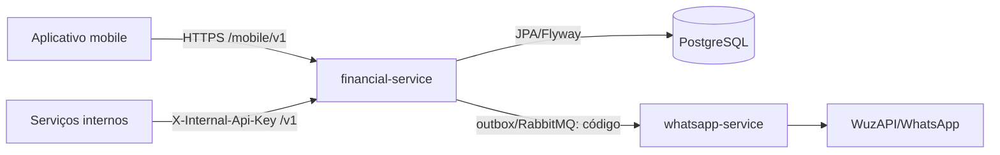

# SDD — API mobile do WhatsApp Finance Tracker

**Estado:** implementação local das etapas 12–26 concluída; execução verde da suíte e homologação de publicação ainda pendentes.  
**Última revisão:** 2026-11-17.  
**Sistema:** `financial-service` (Spring Boot, PostgreSQL, Flyway), integrado ao `whatsapp-service` por RabbitMQ.  
**Fontes:** [quadro de planejamento](https://trello.com/b/F8yyAdHS/planejamento-api-finance-tracker-mobile), [ADR 001](../adr/001-api-mobile-no-financial-service.md), [segurança](../security/mobile-api-security.md), [OpenAPI](../openapi/mobile-api.yml) e código do repositório.

## 1. Objetivo e limites

Oferecer ao aplicativo uma API autenticada para entrar por código enviado no WhatsApp, manter uma sessão renovável, registrar gastos e consultar categorias e relatórios. O `financial-service` hospeda `/mobile/v1/**`; `/v1/**` continua reservado aos serviços internos com `X-Internal-Api-Key`. O gateway público só deve encaminhar `/mobile/v1/**` e o health check estritamente necessário.

O núcleo do MVP é autenticação, sessão, consulta de categorias, criação e consulta de transações, e resumo com navegação para os gastos individuais. Os cartões 15, 18, 21 e parte do 22 acrescentam gerenciamento de aparelhos, perfil, edição de categorias e relatório adicional. Esses itens continuam no plano 12–26, mas devem entrar **depois do núcleo**. A API não inclui edição/cancelamento de gastos, receitas, metas, orçamentos ou extração por IA no aplicativo.

## 2. Situação verificada em 2026-11-17

O quadro marca 00–11 como concluídos. O repositório contém ADR, contrato OpenAPI, política de segurança e SDDs individuais dos cartões 05–11. O código contém as cadeias de segurança, migração `V3__mobile_authentication.sql`, fluxo de solicitação/entrega/confirmação do código, rate limit e testes correspondentes. Isso sustenta o estado **concluído no planejamento**; esta revisão documental não executou a suíte nem fez homologação externa.

Há uma lacuna deliberada entre o código e o contrato: `POST /mobile/v1/auth/codes/verify` responde `204` e `ConfirmacaoCodigoService` devolve somente o ID do usuário e o nome do aparelho. O OpenAPI prevê `200` com access e refresh tokens. Os cartões 12 e 13 fecham essa lacuna. Não se deve alterar o contrato para `204`.

| Etapa | Entrega registrada | Estado | Evidência principal |
| --- | --- | --- | --- |
| 00 | Visão e escopo do MVP | Concluída | [cartão](https://trello.com/c/zb7shUsN) |
| 01 | Arquitetura no `financial-service` | Concluída | [ADR 001](../adr/001-api-mobile-no-financial-service.md) |
| 02 | Contrato HTTP inicial | Concluída | [OpenAPI](../openapi/mobile-api.yml) |
| 03 | Política de segurança e testes | Concluída | [política](../security/mobile-api-security.md) |
| 04 | Spring Security e configuração JWT | Concluída | `SecurityConfiguration`, `JwtConfiguration` |
| 05 | Cadeias interna e mobile | Concluída | [SDD 05](../security/card-05-security-chains-sdd.md) |
| 06 | Persistência de desafio e sessão | Concluída | [SDD 06](../security/card-06-auth-persistence-sdd.md), Flyway V3 |
| 07 | Código seguro de verificação | Concluída | [SDD 07](../security/card-07-verification-code-sdd.md) |
| 08 | Solicitação de código | Concluída | [SDD 08](../security/card-08-request-code-endpoint-sdd.md) |
| 09 | Entrega pelo WhatsApp | Concluída | [SDD 09](../security/card-09-whatsapp-code-delivery-sdd.md) |
| 10 | Confirmação do código | Concluída | [SDD 10](../security/card-10-verify-code-endpoint-sdd.md) |
| 11 | Proteção contra abuso | Concluída | [SDD 11](../security/card-11-auth-abuse-protection-sdd.md) |

## 3. Decisões que orientam a implementação

1. O contrato vigente para o **núcleo do MVP** é `docs/openapi/mobile-api.yml`: caminhos e campos JSON em português (`/categorias`, `/transacoes`, `/relatorios/resumo`, `dataInicio`, `dataFim`). Cartões posteriores usam nomes em inglês (`/categories`, `/transactions`, `/reports/summary`) e pedem rotas adicionais. Antes de implementar cada extensão, atualizar o OpenAPI e decidir uma única convenção pública; não publicar dois conjuntos de rotas por acidente. Este SDD usa os caminhos atuais para o núcleo e chama as extensões pelos caminhos propostos no Trello.
2. A política aprovada em `mobile-api-security.md` prevalece sobre cartões isolados: JWT RS256 de 15 minutos com `sub`, `sid`, `iss`, `aud`, `iat`, `exp`, `jti`; refresh opaco de 256 bits com 30 dias de inatividade e 90 dias absolutos; código de seis dígitos e cinco minutos. Limite por instalação está fora do MVP, embora apareça no cartão 11.
3. Toda identidade financeira vem do `sub` validado. `telefone` e `usuarioId` recebidos do cliente jamais escolhem o proprietário. Cada leitura e escrita deve filtrar pelo usuário autenticado no banco, inclusive quando o ID do recurso é fornecido na URL.
4. O refresh token é apresentado em JSON somente nas rotas de autenticação, sempre com `Cache-Control: no-store`; o aplicativo o guarda em armazenamento seguro. O banco guarda somente seu hash. Logs, métricas e traces não guardam códigos, tokens, chaves nem telefone completo.
5. Valores financeiros usam `BigDecimal` com duas casas e JSON decimal; datas da API usam ISO 8601. Consultas por dia civil e relatórios usam `America/Sao_Paulo`, com intervalos internos `[início, fim)` convertidos a instantes para evitar perda de lançamentos no último dia.
6. A integração WhatsApp existente permanece operante. Transação criada pelo mobile não dispara confirmação por WhatsApp por padrão.

## 4. Arquitetura e fluxos



**Entrada:** app solicita um desafio; serviço aplica limites, persiste HMAC do código e entrega a mensagem via outbox. O app confirma `challengeId` e código. Uma transação no banco consome o desafio e cria a primeira sessão; só após commit a resposta entrega o par de tokens. Falha de emissão deve reverter a confirmação e a sessão, para não consumir o código sem entregar credenciais.

**Uso:** o Bearer JWT atravessa somente a cadeia mobile. O `sub` vira o principal autenticado. O serviço usa esse ID para filtrar categorias, transações e agregações. `sid` permite rastrear a sessão sem consultar o banco em toda requisição. A revogação do refresh não invalida o JWT já emitido: ele expira em até 15 minutos.

**Renovação:** a rota recebe o refresh opaco, calcula seu hash, trava o registro/família, verifica validade e gira para um novo registro. Uma tentativa concorrente com o mesmo token não recebe outro par. Reutilização de um token já utilizado revoga a família; todas as respostas de falha são genéricas.

## 5. Persistência e evolução de esquema

A `V3__mobile_authentication.sql` já criou `tb_desafio_autenticacao` e `tb_sessao_mobile`. Nesta última, `id` identifica o registro do refresh, `sessao_id` identifica a família, `token_anterior_id` forma a cadeia, `usuario_id` fixa o dono, e `usado_em`/`revogado_em` distinguem rotação de revogação. Os índices únicos impedem dois hashes iguais, dois sucessores para um mesmo token e mais de um token ativo por família. Reutilizar essa estrutura antes de acrescentar tabelas.

O próximo Flyway necessário para o domínio financeiro deve adicionar a origem da transação (`WHATSAPP` ou `MOBILE`) com backfill `WHATSAPP` para dados legados e índice/estrutura de idempotência por `(usuario_id, operação, chave)`, com fingerprint da requisição e resposta ou referência do resultado. Uma chave repetida com payload diferente deve resultar em `409`; a mesma chave e payload devolve o mesmo resultado sem novo gasto. A migração precisa ser compatível com a versão antiga durante o rollout.

`tb_transacao` hoje usa `LocalDateTime`, `deletado`, `usuario_id`, `categoria_id` e `external_message_id`; `tb_categoria` usa `ativa`; `tb_usuario` já tem telefone criptografado e hash de busca. Antes dos filtros mobile, fixar a interpretação de `data_hora` legada no fuso de São Paulo e documentar a conversão para instantes. Evitar reescrever os valores existentes sem migração e teste de reconciliação. Categoria desativada permanece referenciada por transações antigas.

## 6. Contratos e regras transversais

| Operação | Segurança | Resultado esperado |
| --- | --- | --- |
| `POST /mobile/v1/auth/codes` | Pública + rate limit | `202`, `challengeId`, prazos |
| `POST /mobile/v1/auth/codes/verify` | Pública + desafio | `200`, par de tokens após 12–13 |
| `POST /mobile/v1/auth/refresh` | Refresh opaco | `200`, novo par; anterior invalidado |
| `POST /mobile/v1/auth/logout` | Refresh opaco | `204` idempotente |
| `GET /mobile/v1/categorias` | Bearer JWT | Categorias ativas próprias |
| `GET /mobile/v1/transacoes` | Bearer JWT | Gastos próprios paginados, por período e categoria opcional |
| `POST /mobile/v1/transacoes` | Bearer JWT + `Idempotency-Key` | Gasto próprio, uma única vez |
| `GET /mobile/v1/relatorios/resumo` | Bearer JWT | Totais do período e `categoryId` para detalhamento |

O OpenAPI atual admite últimas dez transações e período opcional, enquanto o cartão 19 pede `dataInicio` e `dataFim` obrigatórios. Manter o padrão atual para o MVP; se a tela exigir período obrigatório, revisar OpenAPI e aplicativo juntos antes de codificar. O relatório abre `GET /transacoes` com o mesmo período e, ao tocar em categoria, com `categoryId`. Ordenar por data decrescente **e ID decrescente** para paginação estável.

Respostas de erro têm `code`, `message`, `timestamp`, `path`, `correlationId`. Usar `400` para formato, `401` para credencial, `403` para acesso proibido, `404` para recurso próprio inexistente, `409` para conflito, `422` para regra de negócio e `429` para limite com `Retry-After`. Não retornar stack trace nem indicar se um telefone está cadastrado. `X-Correlation-Id` deve atravessar requisição, outbox e logs sem carregar PII.

## 7. Desenho das etapas pendentes

### 12 — Emissão e validação do access token JWT

**Dependências:** 04, 06, 10. **Entrega:** componente `MobileAccessTokenService` que emite RS256 usando a chave privada configurada fora do repositório, `kid` versionado, `sub` igual ao ID estável do usuário, `sid` igual à família de sessão, `iss`, `aud`, `iat`, `exp` e `jti`. O decoder atual já verifica assinatura, emissor e audiência; complementar validação explícita de algoritmo, tipos e presença das claims, e relógio controlável nos testes. A chave deve poder rodar sem invalidar imediatamente tokens ainda válidos. **Aceite:** token válido entra em rota mobile; assinatura alterada, token expirado, audiência/emissor incorretos, `sub`/`sid` ausentes e algoritmo indevido retornam `401`. [Cartão](https://trello.com/c/WhZ5EU9j).

#### Desenho detalhado

- **Entrada:** `usuarioId` e `sessaoId` produzidos pelo fluxo de confirmação. O emissor recebe esses IDs como tipos internos; não recebe claims arbitrárias do controller.
- **Emissão:** construir cabeçalho `alg=RS256`, `typ=JWT` e `kid` da chave ativa. Usar `Clock` injetado para `iat` e `exp=iat+15 min`; criar `jti` aleatório único. `sub` é o ID numérico estável de `tb_usuario` em string decimal e `sid` é UUID da família. Não incluir telefone, nome, e-mail, papel financeiro ou dados de sessão no payload.
- **Validação:** fixar algoritmo aceito no servidor, conferir assinatura com chave pública correspondente ao `kid`, emissor, audiência, tempo e formato de `sub`/`sid`/`jti`. Rejeitar duplicação ou ausência de claims obrigatórias. Permitir pequena tolerância de relógio apenas se definida em configuração e testada.
- **Chaves:** configuração externa deve distinguir chave ativa de emissão e chaves públicas ainda aceitas. A rotação mantém a chave pública antiga até expirar o último JWT de 15 minutos, com margem operacional; a chave privada antiga deixa de emitir imediatamente. Documentar procedimento de troca e rollback.
- **Falha:** chave ausente/inválida impede inicialização; erro de emissão antes do commit da confirmação não consome o desafio. Erro de validação produz `401 INVALID_ACCESS_TOKEN`, sem expor motivo criptográfico ao cliente.

#### Verificação

Testar claims e prazo com relógio fixo; validar token real no filtro HTTP; testar assinatura alterada, `alg=none`, `kid` desconhecido, chave trocada, emissor/audiência errados, expiração e claims malformadas. Verificar que uma chave interna não concede acesso mobile e que o JWT não concede acesso a `/v1/**`.

### 13 — Refresh token persistido e criação da sessão

**Dependências:** 06, 10, 12. **Entrega:** gerar 32 bytes com `SecureRandom`, codificar em Base64URL sem padding, persistir somente SHA-256 do valor (suficiente para token aleatório de 256 bits), criar família (`sessao_id`), usuário, nome de aparelho apenas informativo e prazos de 30/90 dias. Integrar criação da sessão e emissão do access token à confirmação do código; mudar o controller de `204` para `200 TokenResponse` conforme OpenAPI. Garantir atomicidade da confirmação com a sessão, sem reaproveitar código após sucesso. **Aceite:** nenhum valor original no banco/log; login confirmado produz um par utilizável e uma família revogável; falha de persistência não consome definitivamente o desafio. [Cartão](https://trello.com/c/4erft10G).

#### Desenho detalhado

1. O serviço de confirmação mantém o bloqueio pessimista do desafio, valida o código, localiza/cria o usuário e chama um serviço de sessão dentro da **mesma transação**. O serviço de sessão gera `id` do registro, `sessao_id` da família, refresh token e hash, e salva `tb_sessao_mobile`. Só então o desafio é consumido.
2. Calcular `expira_inatividade_em = agora + 30 dias` e `expira_absoluto_em = agora + 90 dias`. Na renovação, usar o menor entre `agora + 30 dias` e o prazo absoluto. O schema exige que o limite de inatividade seja anterior ou igual ao absoluto.
3. O resultado de sucesso contém `accessToken`, `tokenType=Bearer`, `accessTokenExpiraEmSegundos=900`, `refreshToken` e `refreshTokenExpiraEmSegundos` conforme OpenAPI. Definir o último valor como prazo restante efetivo do refresh, não como uma promessa fixa de 90 dias.
4. `nomeDispositivo` é texto não confiável e opcional; limitar tamanho, normalizar espaços e não usá-lo para autenticação. Uma nova confirmação cria outra família, permitindo mais de um aparelho.
5. O refresh original existe somente na memória do processo e na resposta HTTPS. Nunca é salvo na entidade, enviado ao outbox ou incluído em exceções. Adotar comparação de hash sem vazamento observável e índice único já previsto em V3.

**Falhas e transação:** uma falha ao salvar sessão, emitir JWT ou construir a resposta antes do commit deve reverter consumo do desafio e criação de usuário/sessão. Após commit, se o cliente perder a resposta, o código já estará consumido; o app deve solicitar novo código. Documentar essa característica na integração, sem tentar devolver tokens antigos.

**Verificação:** teste de integração confirma uma linha ativa por login, `refresh_token_hash` diferente do token original, prazos corretos e resposta `200/no-store`; erro induzido de persistência faz rollback; duas confirmações concorrentes produzem no máximo um par utilizável.

### 14 — Rotação e detecção de reutilização

**Dependências:** 12–13. **Entrega:** `POST /mobile/v1/auth/refresh`. Bloquear a família/registro com transação, validar hash e prazos, marcar token usado e gravar sucessor com o mesmo `sessao_id`; atualizar inatividade sem ultrapassar o limite absoluto. Registrar estado antigo pelo tempo necessário à detecção de replay. Replay revoga os registros ativos da família. Evitar que duas renovações concorrentes criem dois sucessores. **Aceite:** primeiro refresh retorna novo par; segundo uso do anterior recebe `401` e invalida a família; expiração e revogação retornam `401`; teste concorrente em PostgreSQL real. [Cartão](https://trello.com/c/hiCpjjmP).

#### Estados e algoritmo

| Estado do registro encontrado | Condição | Ação |
| --- | --- | --- |
| Ativo | Não usado, não revogado e dentro dos dois prazos | Girar token e devolver novo par |
| Usado | `usado_em` preenchido | Tratar como reutilização; revogar a família |
| Revogado | `revogado_em` preenchido | `401` genérico, sem nova emissão |
| Expirado | Qualquer prazo vencido | `401`; impedir sucessor |
| Desconhecido | Hash inexistente | `401` genérico |

O endpoint calcula o hash do token apresentado e busca o registro. A transação trava a família de modo que dois nós não girem o mesmo token simultaneamente. Confere que aquele registro é o ativo, marca `usado_em`, gera um novo token de 256 bits, salva o sucessor com `token_anterior_id` e preserva `sessao_id`, `usuario_id`, nome do aparelho e prazo absoluto. A operação de banco termina antes de escrever a resposta. Se a criação do sucessor falhar, a transação inteira reverte, deixando o token anterior ativo.

Há uma decisão operacional importante: uma repetição causada por perda de resposta é indistinguível de roubo do token antigo. O comportamento aprovado é revogar a família mesmo nesse caso; o aplicativo deve voltar ao login. A resposta não informa se a causa foi replay, expiração ou desconhecimento, enquanto métrica interna registra a categoria sem guardar o token.

**Verificação:** testes com duas transações reais concorrentes, repetição após rotação, expiração por inatividade e absoluta, rollback induzido e dois aparelhos distintos. Verificar que replay de uma família não revoga outra família do mesmo usuário.

### 15 — Logout e gerenciamento de sessões

**Dependências:** 13–14. **Entrega do núcleo:** `POST /mobile/v1/auth/logout` com refresh token e `204` idempotente. **Extensão posterior:** lista de aparelhos e revogação individual/global. Os caminhos propostos no cartão (`GET/DELETE /mobile/v1/auth/sessions...`) devem ser acrescentados ao OpenAPI antes de implementar. Autorizar por `sub` e responder `404` para sessão alheia, sem revelar sua existência. **Aceite:** refresh revogado falha imediatamente; tokens de acesso previamente emitidos podem viver até 15 minutos; um usuário não lista/revoga sessão de outro. [Cartão](https://trello.com/c/NZQ3dFzk).

#### Operações

- `POST /auth/logout`: receber refresh token no corpo, localizar por hash e revogar a família a que pertence. Devolver `204` para token válido, revogado ou inexistente. Usar `no-store` e não registrar o corpo. Se o token antigo já foi rotacionado, a política de replay de 14 continua aplicável; o logout não deve mascarar uma renovação simultânea que emitiu outro token ativo.
- `GET /auth/sessions`: exigir Bearer e listar uma linha por `sessao_id` do `sub`, com ID de sessão, nome informado, criação, último uso, expiração e indicador de aparelho atual derivado do `sid` do JWT. Não retornar hash, cadeia ou dados de outros usuários.
- `DELETE /auth/sessions/{id}`: exigir Bearer; revogar a família selecionada **com `usuario_id` no predicado**. `404` tanto para ID inexistente quanto alheio. Repetir a operação para sessão própria já revogada pode ser `204`, desde que o OpenAPI registre a escolha.
- `DELETE /auth/sessions`: exigir Bearer; revogar todas as famílias do `sub` em uma transação. Acesso com JWT já emitido permanece até o prazo de 15 minutos, conforme política.

**Conflito de autorização:** a rota básica de logout é pública no filtro de segurança porque autentica pelo refresh token. As rotas de gestão de sessões não são públicas: exigem JWT e principal. Testar explicitamente o matcher de cada método/caminho.

**Verificação:** duas famílias do mesmo usuário e uma de outro usuário; revogação atual, específica e global; refresh após revogação; tentativa de adivinhar ID alheio; resposta sem detalhes sensíveis.

### 16 — Principal autenticado e isolamento por usuário

**Dependências:** 05, 12. **Entrega:** resolvedor tipado do `sub` validado para `usuarioId`, usado nos controllers e serviços mobile. Repositórios expõem operações com `usuario_id` no predicado; não buscar por ID e checar dono depois. DTOs financeiros não recebem telefone nem ID de usuário. **Aceite:** trocar ID de categoria, transação, sessão ou query nunca retorna nem altera recurso alheio; JWT não habilita `/v1/**`. [Cartão](https://trello.com/c/OTuVMyLm).

#### Fronteira de confiança

O filtro valida o JWT; um componente de aplicação converte `sub` para `Long`, rejeitando ausente, não numérico, zero/negativo ou usuário removido. O controller injeta o principal tipado e passa o ID ao serviço. Os serviços recebem explicitamente `usuarioId` confiável; nenhum método mobile resolve usuário a partir de telefone do request.

As operações de repositório devem ter assinatura equivalente a `findByIdAndUsuarioId`, `findByUsuarioIdAnd...` e agregações filtradas por `usuario_id`. Para ID de recurso alheio, responder `404` como para recurso inexistente quando a distinção revelaria existência. Em POST, consultar categoria por `(id, usuario_id, ativa=true)` antes de vincular à transação; repetir o filtro na própria query de atualização quando houver risco de corrida.

**Verificação:** matriz A/B cobrindo listagem, criação de gasto com categoria alheia, detalhe, relatório, perfil e sessões. Testar campos extras `usuarioId`/`telefone` no corpo e query: rejeitar entrada desconhecida quando a política de desserialização permitir ou ignorá-la sem efeito, mas nunca usá-la como identidade.

### 17 — DTOs, validação e erros

**Dependências:** 02, 16. **Entrega:** DTOs exclusivos mobile com Bean Validation, serialização camelCase, `BigDecimal` e datas ISO 8601; handler comum para erros de controller, domínio e segurança. Preservar `correlationId` e `no-store` nas respostas sensíveis. Atualizar os exemplos OpenAPI após cada rota. **Aceite:** 400/401/403/404/409/422/429 seguem o mesmo esquema, sem detalhes internos, com testes de contrato. [Cartão](https://trello.com/c/ayu13Fa9).

#### Modelo de contrato

```json
{
  "code": "INVALID_CATEGORY",
  "message": "A categoria informada não está disponível",
  "timestamp": "2026-11-17T12:00:00-03:00",
  "path": "/mobile/v1/transacoes",
  "correlationId": "b5f670f5-a9b8-4597-ad03-2af7b35fb391"
}
```

`code` é estável para o aplicativo; `message` é legível, mas não serve como chave de lógica. `timestamp` inclui deslocamento UTC. `path` exclui query string e segredos. `correlationId` corresponde ao header de resposta. O handler deve mapear exceções de Bean Validation, JSON inválido, regra de domínio, conflito de unicidade, autenticação e autorização sem transformar erro inesperado em `200` ou revelar stack trace.

| Caso | HTTP | Observação |
| --- | --- | --- |
| JSON/campo/data inválidos | 400 | Não ecoar valor sensível |
| Código/token inválido ou vencido | 401 | Mensagem genérica |
| Operação proibida | 403 | Não usar para revelar recurso alheio |
| Recurso próprio inexistente ou ID alheio | 404 | Mesma resposta externa |
| Chave idempotente com payload diferente | 409 | `code` próprio e estável |
| Regra de negócio não representável como formato | 422 | Ex.: categoria inativa, se contrato escolher 422 |
| Limite de uso | 429 | `Retry-After` em segundos |

**Verificação:** casos HTTP reais para cada status, comparação de exemplos/schema OpenAPI, `Content-Type`, `Cache-Control`, correlation ID e ausência de stack trace/corpo de token em log.

### 18 — Perfil do usuário

**Dependências:** 16–17. **Extensão posterior ao núcleo:** `GET /mobile/v1/me`, documentado antes no OpenAPI. Retornar ID público estável, nome/e-mail se houver, telefone mascarado, cadastro e preferências realmente usadas no app. Nunca retornar telefone cifrado, hash ou dados de sessão. Se não existir um ID público separado, decidir se o ID atual pode ser exposto ou criar identificador próprio por migração. **Aceite:** dados pertencem exclusivamente ao `sub`; campos ausentes têm representação estável. [Cartão](https://trello.com/c/P3Ytl7yQ).

#### Representação e privacidade

O endpoint lê `tb_usuario` pelo `sub`, sem parâmetro de ID. Nome e e-mail são opcionais no modelo atual; representar ausência como `null` ou omitir de forma consistente com o schema, sem inventar valores. O telefone é descriptografado apenas no serviço responsável por mascará-lo, e a resposta mostra apenas os últimos dígitos necessários à identificação do número. O campo de cadastro deve indicar explicitamente o fuso/offset; `data_cadastro` legado é `LocalDateTime`, então a interpretação precisa seguir a decisão de fuso do item 5.

O cartão pede “preferências necessárias ao app”, mas o modelo atual não tem preferências. Primeiro inventariar necessidades reais da interface e acrescentar somente campos usados; evitar um objeto vazio apresentado como funcionalidade pronta. Não criar fluxo de edição de perfil implicitamente nesta etapa.

**Falhas e verificação:** usuário do `sub` ausente resulta em `401` ou `404` conforme decisão documentada no contrato, sem consultar outro usuário. Testar perfil com nome/e-mail presentes e ausentes, máscara de números curtos/inválidos legados, e serialização sem `telefoneCriptografado`, `telefoneHash` ou IDs de sessão.

### 19 — Transações mobile

**Dependências:** 16–17. **Entrega:** `GET/POST /mobile/v1/transacoes` conforme contrato atual. GET filtra `usuario_id`, `deletado=false`, período e `categoryId` opcional; ordena `(data_hora DESC, id DESC)` e pagina. POST recebe valor positivo, descrição e categoria própria ativa, usa `BigDecimal`, atribui usuário do principal e retorna ID, valor, categoria e instante. Não reutilizar DTO interno que aceita telefone. **Aceite:** registro e listagem funcionam para o mesmo usuário; categoria alheia/inativa é rejeitada; detalhe do relatório usa a listagem; não há vazamento entre usuários. [Cartão](https://trello.com/c/s6UduTz8).

#### Consulta

- Usar o contrato atual: sem datas, devolver a janela padrão de últimas dez; com datas, exigir as duas e validar `dataInicio <= dataFim` e limite máximo definido. `categoryId` é filtro adicional, não identidade.
- Converter dias locais em intervalo `[dataInicio 00:00, dia após dataFim 00:00)` no fuso São Paulo. A query usa `usuario_id`, `deletado=false`, intervalo e categoria opcional no banco; não filtrar coleção em memória.
- Definir `page` e `size` com limites explícitos no OpenAPI; retornar metadados de paginação e ordenação estável por `(data_hora DESC, id DESC)`. Se uma transação surgir entre páginas offset, o cliente pode ver deslocamento; se isso for inaceitável, evoluir para cursor em versão futura.
- A resposta inclui ID, valor decimal, descrição, data/hora e `categoryId`/nome. Categoria inativa continua visível em transação histórica.

#### Registro

Validar valor maior que zero, escala de duas casas, descrição não vazia e tamanho máximo, e categoria do usuário ativa. O serviço de domínio persiste em transação única. A origem `MOBILE` e a idempotência são completadas em 20; até lá, o POST não deve ser exposto em produção como pronto. Responder `201` com corpo e localização somente se o OpenAPI confirmar esse contrato.

**Verificação:** usuário A/B, categoria alheia/inativa, período de um dia, limites de data, empate em `data_hora`, paginação, transação deletada, valor com mais de duas casas e tratamento de datas na virada de horário.

### 20 — Idempotência e origem da transação

**Dependência:** 19. **Entrega:** `Idempotency-Key` obrigatório no POST mobile; chave escopada a usuário/operação, fingerprint do payload canônico, gravação atômica do resultado e tratamento de corrida com índice único. A mesma chave/payload devolve a resposta original; payload diferente gera `409`. Persistir origem `MOBILE`/`WHATSAPP` com backfill e separar a gravação da escolha de notificar. **Aceite:** timeout/retry não duplica gasto; lançamento mobile não gera mensagem inesperada; lançamento via WhatsApp conserva o fluxo atual. [Cartão](https://trello.com/c/rNW78bgX).

#### Modelo de idempotência

Uma tabela própria guarda `usuario_id`, operação (por exemplo `CREATE_TRANSACTION`), hash da chave, fingerprint canônico dos campos que afetam o gasto, ID da transação criada, status HTTP e instante de criação. O índice único `(usuario_id, operação, chave_hash)` é a garantia final de concorrência. O hash da chave evita guardar identificadores fornecidos pelo cliente em texto puro; o fingerprint detecta mudança de payload sob a mesma chave.

Dentro da transação de criação, reservar a chave, validar categoria e payload, criar o gasto e associar o resultado. Um retry encontra o resultado persistido e devolve o mesmo ID, corpo e status. Se a primeira tentativa ainda está em andamento, serializar pelo índice/bloqueio e então ler o resultado; não criar gasto provisório adicional. Definir no OpenAPI tamanho/formato da chave e tempo de retenção. Uma chave expirada pode voltar a ser usada apenas depois do prazo documentado; o app não deve reciclar chaves de operações diferentes.

#### Origem e notificações

A migração cria origem com valor padrão/backfill seguro para registros existentes (`WHATSAPP`). O listener existente continua criando transações com `WHATSAPP` e seu `external_message_id`; o controller mobile cria com `MOBILE` e não publica confirmação WhatsApp. A decisão de notificar pertence ao fluxo/canal após persistência, não à entidade de transação. Um teste de regressão deve mostrar que o outbox do WhatsApp não recebe evento de confirmação para POST mobile.

**Verificação:** mesmo payload/chave sequencial e concorrente, payload diferente/chave igual, chave igual para usuários distintos, timeout simulado após commit, ausência de mensagem WhatsApp no mobile e mensagem preservada no fluxo antigo.

### 21 — Categorias mobile

**Dependências:** 16–17. **Entrega do núcleo:** `GET /mobile/v1/categorias` retorna apenas categorias próprias ativas. **Extensão posterior:** criar, reativar, renomear e desativar por `POST/PATCH/DELETE`; documentar caminhos escolhidos no OpenAPI. Garantir unicidade por usuário para nome normalizado, proteger “Outros” e preservar referência histórica das transações. **Aceite:** usuário não altera categoria alheia; desativação não apaga gastos; reativação não duplica nome. [Cartão](https://trello.com/c/nq8LYQkH).

#### Regras de domínio

GET ordena categorias próprias ativas por nome, com ID e nome; se o app de gestão precisar, criar parâmetro explícito para incluir inativas, autorizado pelo mesmo principal. Para criação/renomeação, normalizar espaços e caixa para comparação, mas preservar grafia de exibição. A unicidade deve ser garantida também no banco, com estratégia definida para dados legados que já possuam nomes duplicados. “Outros” exige identificação estável de categoria padrão; não confiar só na grafia, que pode variar em registros antigos.

`DELETE` desativa (`ativa=false`) sem apagar a linha, pois transações históricas referenciam `categoria_id`. Ao criar nome que já existe inativo, reativar conforme regra do cartão, em vez de inserir duplicata. Ao renomear, usar `(id, usuario_id)` no predicado. Uma categoria inativa não recebe novo gasto; a listagem de transações e relatórios continua mostrando seu nome histórico.

**Contrato:** documentar no OpenAPI se POST retorna `201` na criação e `200` na reativação, como PATCH lida com nome idêntico e se DELETE é idempotente. Evitar respostas diferentes que revelem categoria de outro usuário.

**Verificação:** A/B, nome duplicado com diferenças de caixa/espaço, reativação, proteção de “Outros”, desativação com transações antigas e concorrência de duas criações com mesmo nome.

### 22 — Relatórios mobile

**Dependências:** 16–17, 19. **Entrega do núcleo:** `GET /mobile/v1/relatorios/resumo`, com padrão de 30 dias ou `dataInicio`/`dataFim`, teto de um ano e fuso São Paulo. Agregar somente transações próprias não deletadas, total geral, quantidade e totais por categoria com `categoryId` e nome histórico. **Extensão posterior:** relatório `by-period` proposto no Trello, com caminho e semântica definidos no OpenAPI antes de codificar. **Aceite:** somar a listagem completa do mesmo intervalo reproduz total e agrupamentos; toque no total/categoria abre lista correta. [Cartão](https://trello.com/c/3NtfS8ke).

#### Cálculo e navegação

Resolver o período uma vez em componente compartilhado com GET de transações. O padrão de “30 dias” precisa ser explícito: 30 dias civis incluindo hoje ou 30×24 horas; usar dias civis de São Paulo para alinhar à interface e registrar no OpenAPI. Rejeitar apenas uma das datas, intervalo invertido ou superior a um ano. Agregar no banco com `SUM(BigDecimal)` e `COUNT`, sempre por `usuario_id` e `deletado=false`.

O total geral é a soma de todas as transações elegíveis, inclusive categorias hoje inativas. Cada grupo devolve `categoryId`, nome e total. Para período sem gasto, retornar total `0.00`, quantidade zero e grupos vazios. O link de detalhamento não precisa ser URL montada no backend: o app chama GET de transações com as mesmas datas e `categoryId` quando aplicável.

O cartão pede `by-period`, mas o OpenAPI atual só define resumo. Antes da extensão, estabelecer se significa série diária, semanal ou mensal, limites de pontos e preenchimento de intervalos sem gasto; só então adicionar rota/schema. Não duplicar o resumo com outro nome.

**Verificação:** comparar soma das páginas completas com resumo e grupos, inclusive categoria inativa, transação deletada, limites de ano, mês curto, mudança de ano, período vazio e usuário A/B.

### 23 — Testes de autenticação, sessão e concorrência

**Dependências:** 10–15. **Entrega:** unitários com `Clock` injetado e integração com PostgreSQL/Testcontainers para confirmação única, limites, JWT válido/inválido, criação, renovação, replay, expiração e logout. Usar barreiras de concorrência determinísticas e verificar estado do banco, além do HTTP. **Aceite:** dois pedidos simultâneos com o mesmo código ou refresh não criam duas sessões/renovações; regressões de segurança falham na suíte. [Cartão](https://trello.com/c/pwQIWEHN).

#### Matriz de testes

| Camada | Cenários obrigatórios | Evidência |
| --- | --- | --- |
| Unitária | geração/HMAC do código; prazos; claims JWT; hash de refresh; estados de sessão | Valores e transições com `Clock` fixo |
| HTTP | código ausente/inválido/expirado/usado; token inválido; erros e headers | Status, corpo, `no-store`, `Retry-After` |
| Integração PostgreSQL | Flyway; criação de família; unicidade; rotação; replay; revogação | Linhas e índices reais |
| Concorrência | duas confirmações do mesmo desafio; dois refreshes do mesmo token | No máximo um sucesso e um sucessor |
| Regressão | autenticação `/v1/**` e fluxo de código existente | Rotas internas não aceitam JWT mobile |

Concorrência deve usar duas conexões/transações de verdade, com barreira que faça as requisições disputar o mesmo registro. Mock sequencial não prova comportamento do índice e do lock. A suíte também testa rollback quando a escrita do sucessor falha, para garantir que o token anterior não ficou consumido sem substituto.

**Dados de teste:** gerar chaves e tokens efêmeros; nunca usar chave real de ambiente. Limpar registros entre testes, controlar relógio e evitar esperas reais de 5/15/60 minutos. Registrar no CI quais testes exigem Docker/Testcontainers.

### 24 — Testes de autorização e contrato

**Dependências:** 17–22. **Entrega:** matriz de dois usuários para cada leitura/escrita, validação de filtros/paginação, erro uniforme, idempotência, comparação com OpenAPI e regressão das rotas internas e do fluxo WhatsApp. Verificar também que `X-Internal-Api-Key` não autentica mobile e Bearer mobile não autentica `/v1/**`. **Aceite:** testes provam isolamento dos dados e compatibilidade do contrato público. [Cartão](https://trello.com/c/pPITewMF).

#### Matriz de autorização e contrato

Criar usuário A e B com categorias, transações e sessões diferentes. Para cada endpoint, exercer: sem credencial, JWT A, JWT B, JWT inválido e chave interna. IDs de B enviados por A devem ser tratados como recurso ausente ou operação inválida, sem alterar B. Consultas agregadas precisam provar que o filtro de usuário está na query do banco e não só no controller.

| Área | Casos de contrato | Regressão relevante |
| --- | --- | --- |
| Categorias | ativas, inativas, própria/alheia, nome duplicado | categoria “Outros” e transações antigas |
| Transações | período, categoria, paginação, ordem estável, valor decimal | listener WhatsApp e `external_message_id` |
| Relatórios | padrão, intervalo, vazio, soma por categoria | valores batem com GET de transações |
| Sessões/perfil | identidade do `sub`, revogação própria/alheia | token mobile não acessa `/v1/**` |
| Erros | schema, códigos, headers e correlação | sem stack trace/segredo |

Validar o OpenAPI com parser/linter e testar as respostas implementadas contra seus schemas. Qualquer escolha feita em 15, 18, 21 ou `by-period` deve aparecer no contrato antes de ser considerada pronta. O endpoint de criação deve provar idempotência sequencial e concorrente, além de ausência de confirmação WhatsApp.

### 25 — Observabilidade e retenção

**Dependências:** 11, 14, 17. **Entrega:** correlation ID em HTTP, outbox e logs; contadores de solicitação/confirmação/falha, rate limit, refresh, replay e logout, com etiquetas de baixa cardinalidade; alertas para anomalias. Tarefa de limpeza para desafios vencidos e sessões vencidas/revogadas, preservando por tempo definido os hashes necessários a detectar replay e atendendo à política de retenção. **Aceite:** diagnóstico de uma falha sem ler segredo ou telefone completo; teste/inspeção confirma ausência de PII nos logs. [Cartão](https://trello.com/c/HcgIoHsE).

#### Eventos e métricas

| Evento | Campos seguros para log | Métrica sugerida |
| --- | --- | --- |
| Código solicitado/enviado | `correlationId`, `challengeId`, resultado, latência | contagem de solicitação e entrega |
| Código confirmado/rejeitado | `correlationId`, `challengeId`, categoria de falha | taxa de sucesso/falha |
| Rate limit | `correlationId`, regra atingida, espera | bloqueios por regra |
| Refresh/logout | `correlationId`, ID da família, resultado | renovação, replay, revogação |
| Transação mobile | `correlationId`, ID da transação, origem, resultado | criação e conflito idempotente |

Não usar telefone, token, hash de token, código, `Idempotency-Key`, descrição do gasto ou chave criptográfica como etiqueta de métrica. IDs de alta cardinalidade também não entram em labels; podem aparecer em log restrito quando necessários, com retenção apropriada. Exceções não devem serializar `Authorization` ou corpo da requisição.

#### Limpeza e alertas

Definir retenção concreta em configuração e documentação operacional antes de ativar o job. Desafios consumidos/vencidos podem ser removidos após a janela necessária a auditoria e rate limit. Registros de refresh usados precisam permanecer tempo suficiente para detectar reutilização enquanto a família poderia estar ativa; apagar cedo demais transforma replay em “desconhecido” e impede revogação. Limpeza em lotes pequenos, indexada, observável e idempotente.

Alertar para aumento de falhas de entrega, 429, códigos inválidos, replay, 5xx e latência do banco/outbox. Antes de definir limiar, registrar uma linha de base em homologação/produção; evitar alerta por um único usuário errando o código.

**Verificação:** inspeção de logs com valores sentinela de telefone/código/token, métrica sem labels sensíveis, correlação entre HTTP e entrega, job executado duas vezes sem efeitos adversos e replay ainda detectado dentro da retenção.

### 26 — Publicação e documentação

**Dependências:** 23–25. **Entrega:** gateway com HTTPS e só rotas públicas necessárias, segredos externos, configuração por ambiente, health checks, rollback, OpenAPI final e guia mobile de armazenamento seguro e renovação. Homologar em ambiente real: solicitar código → receber no WhatsApp → confirmar → registrar gasto → consultar relatório/detalhe → renovar → sair. Incluir cenário de deploy gradual e migrações reversíveis ou plano de restauração. **Aceite:** jornada ponta a ponta via HTTPS, proteção da API interna verificada e documentação suficiente para integrar o app. [Cartão](https://trello.com/c/7ds7SmuJ).

#### Preparação de ambiente

- **Rede:** TLS termina no gateway confiável; somente `/mobile/v1/**` é público. `/v1/**`, actuator sensível, banco e RabbitMQ não são publicados. Definir confiança em proxy para IP real sem aceitar `X-Forwarded-For` arbitrário do cliente, pois o rate limit depende dele.
- **Segredos:** chave privada JWT, chave de HMAC de código, chave de proteção do telefone, credenciais de banco/mensageria e chave interna são injetadas por ambiente, com permissões mínimas. Nenhuma aparece em imagem Docker, `.env` versionado, log ou exemplo de resposta.
- **Banco:** aplicar Flyway antes de liberar novo tráfego. Migrações aditivas e backfill devem coexistir por uma versão com o código anterior; registrar backup e procedimento de restauração. Não prometer rollback SQL automático para alterações de dados.
- **Saúde:** health check verifica prontidão do serviço sem expor detalhes internos ao público. Métricas e alertas precisam estar ativos antes de ampliar tráfego.

#### Homologação ponta a ponta

1. Solicitar código de um telefone de teste, recebê-lo via WhatsApp e verificar que resposta/log não o revelam.
2. Confirmar uma vez e obter par de tokens; confirmar novamente falha. Sem token, rota financeira retorna `401`.
3. Consultar categorias, registrar gasto com `Idempotency-Key`, repetir o POST e confirmar um único registro e nenhuma confirmação inesperada no WhatsApp.
4. Consultar resumo e abrir lista completa e filtro por categoria; conferir totais, período, paginação e isolamento com segundo usuário.
5. Renovar sessão, tentar reutilizar refresh antigo e verificar revogação da família; repetir login e executar logout idempotente.
6. Validar que HTTPS é obrigatório, que `/v1/**` não está publicamente acessível e que chaves/tokens não aparecem em logs.

#### Entregáveis finais

Publicar OpenAPI coerente com código, guia de login/refresh/armazenamento seguro para o app, variáveis de ambiente documentadas sem valores reais, procedimento de rotação de chaves, retenção, troubleshooting com correlation ID e runbook de rollback. Registrar evidência de homologação e versão implantada no cartão 26.

## 8. Ordem de execução e marcos

1. **Sessão utilizável:** 12 → 13 → 14 → logout básico de 15 → 23. Fechar a divergência `verify 204` versus `200` antes de começar o app.
2. **Dados do MVP:** 16 → 17 → GET de 21 → 19 → 20 → resumo de 22 → 24. O POST de transação só fica pronto para produção após 20.
3. **Operação e entrega:** 25 → 26. Executar a jornada de homologação e verificar limites, isolamento e regressão do WhatsApp.
4. **Extensões planejadas:** gerenciamento de sessões de 15, perfil de 18, escrita de categorias de 21 e relatório adicional de 22. Cada extensão exige ajuste do OpenAPI, teste de autorização e definição de uso no aplicativo.

## 9. Definition of Done

Cada etapa pendente termina com código e Flyway quando aplicável, OpenAPI atualizado, teste do caminho feliz e dos erros relevantes, teste de isolamento quando há recurso do usuário, revisão de logs/segredos e evidência de regressão do canal WhatsApp. Para publicar: suíte automatizada verde em PostgreSQL real, cenário ponta a ponta em homologação, HTTPS, segredos fora do Git, rollback exercitado e nenhum endpoint interno exposto publicamente.

## 10. Fechamento da implementação local

As etapas 12–26 foram implementadas neste repositório: emissão/validação JWT RS256 com rotação por `kid`; criação, rotação, replay, logout e gestão de sessões; principal mobile e isolamento por usuário; tratamento comum de erros; perfil com identificador público; consulta e criação idempotente de transações; manutenção de categorias; resumo e série diária por período; retenção, correlação e métricas; e documentação de integração, operação e gateway. O OpenAPI e as migrações V4–V6 acompanham o código.

Foram acrescentados testes unitários e de integração PostgreSQL para tokens, sessões, migrações, autenticação, idempotência, isolamento, listagem, categorias, perfil e relatórios. Verificação local em 2026-11-17: `mvn test` passou com **129 testes, zero falhas e zero erros**, incluindo PostgreSQL 15 em Testcontainers e aplicação das seis migrações Flyway. A jornada ponta a ponta em homologação, HTTPS, exercício de rollback e registro da versão implantada continuam sendo verificações de publicação, fora desta implementação local.
